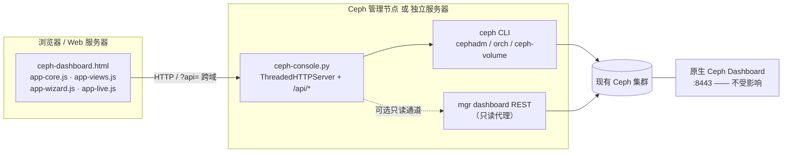

# Ceph Ops Console

面向运维团队的 **Ceph 集群监控告警 + 磁盘运维控制台**。

- 兼容 Ceph 12.x ~ 19.x 与主流 Linux 发行版，一键部署并对接**现有**集群；
- Web 页面直接 **一键踢盘 / 一键换盘 / 一键 IN 盘**，带告警中心与变更审计；
- 真实后端（Ceph CLI / mgr Dashboard REST），**不含任何内置演示数据**；
- **完全不改动、不占用原生 Ceph Dashboard**；
- 支持「管理节点一体化启动」和「前端与后端分离部署」两种形态；
- 后端仅依赖 Python 3.6+ 标准库，前端零 CDN、零构建、可离线运行。

> ⚠️ 快速开始的安装命令带 `--allow-write`，但**装完默认仍是 DRY-RUN**：需要在「系统设置 → 安全策略」里由 admin 输入自己的密码，打开「允许真实写操作」后才会真正下发。去掉 `--allow-write` 则无论开关如何都只生成命令（只写审计，不改集群）。执行闸门与风险控制见 [一键踢盘 / 换盘 / IN 盘](#一键踢盘--一键换盘--一键-in-盘)。

---

## 目录

- [核心能力](#核心能力)
- [架构](#架构)
- [兼容性](#兼容性)
- [快速开始](#快速开始)
- [登录与权限](#登录与权限)
- [一键踢盘 / 换盘 / IN 盘](#一键踢盘--一键换盘--一键-in-盘)
- [创建存储池](#创建存储池)
- [告警中心](#告警中心)
- [安全设计](#安全设计)
- [配置与文件位置](#配置与文件位置)
- [后端 API](#后端-api)
- [部署参数速查](#部署参数速查)
- [卸载](#卸载)
- [常用运维](#常用运维)
- [升级已部署实例](#升级已部署实例)
- [登录后没有真实数据](#登录后没有真实数据)
- [常见问题](#常见问题)
- [目录结构](#目录结构)

---

## 核心能力

| 能力 | 说明 |
| --- | --- |
| 集群概览 | HEALTH 状态、OSD 上下线、容量与 PG 状态、活跃告警、SVG 趋势图 |
| 告警中心 | 四级告警分级统计、筛选/确认/静默、告警定位到 OSD / 主机 / 盘符（只读，无处置按钮） |
| OSD / 磁盘 | OSD 列表（服务器名 + IP + 真实设备映射）、元数据查询、行内 OUT / IN 切换、一键踢盘换盘 |
| 存储池 / 主机 | 存储池用量与创建（replicated / EC）、主机与 MON 视图 |
| 一键踢盘 | 停止 OSD 守护进程 → 标记 DOWN → 标记 OUT → 健康验证 → 回读复核（**不退役**，不清 CRUSH 条目、不清盘） |
| 一键换盘 | 停服务 → OUT → 移除但**保留编号**（`--replace`）→ 现场换盘（暂停）→ 清理新盘 → 用原编号重建 → 回读复核（**OSD 编号不变**） |
| 新增磁盘 | 预检新盘 → 清理元数据 → 创建 OSD（**新编号**）→ 等待上线 → 健康验证（扩容加盘） |
| 一键 IN 盘 | 确认仍在 CRUSH → `ceph osd in` → 恢复权重并回填 → 健康验证（OUT 状态时才显示入口） |
| 高级向导 | 5 步流程，逐步展示命令、预检项与执行结果 |
| 变更审计 | jsonl 全量记录（时间、用户、目标、命令、DRY-RUN / EXECUTED / REJECTED、来源 IP） |
| 部署与对接 | 部署命令生成、运行环境探测、版本与发行版兼容矩阵 |
| 登录 | 账号密码登录、admin / viewer 角色、会话过期、失败限速 |
| 主题 | 深色 / 浅色切换，纯前端实现 |

### 界面数值来源对照

控制台**没有任何写死的业务数字**，每个数值都能追到一条 Ceph 命令；后端没给的一律显示 `—` 或「未采集」。

| 界面 / 字段 | 数据来源 | 取不到时 |
| --- | --- | --- |
| 概览：健康、容量、OSD up/in、告警数 | `ceph status`（`health` / `osdmap` / `pgmap`）+ 告警规则 | 整页显示「集群数据未就绪」诊断页 |
| 概览：PG 总数、active+clean、degraded、MON 法定人数、池数量 | `pgmap.num_pgs`、`pgmap.pgs_by_state`、`ceph quorum_status`（缺失时回落 `ceph mon dump`，最后才用 `status.monmap`）、`ceph osd pool ls detail` | `—` |
| 概览：容量趋势 / IOPS 趋势 | `/api/history`（后端每 60 秒真实采样，落盘 24h） | 「暂无真实历史数据」 |
| 存储池：池清单 / 类型 / size / min_size / PG / 应用 | `ceph osd pool ls detail`（`pg_num`、`pgp_num`、`type`、`application_metadata` 都在这里；`ceph df detail` 的池条目**没有** PG 和 application 字段，只能补用量） | `—` / 「未采集」 |
| 存储池：用量 / 水位 | `ceph df detail` 的 `stats.bytes_used` / `stats.max_avail`（物理口径，含副本冗余；逻辑写入见 `stats.stored`，表格悬停可见） | 「未采集」 |
| 存储池：回填 PG、恢复速率、增长速率 | `pgmap` 实时 + 24h 采样 | `—` / 「累积中」 |
| 主机：主机名、地址、MON/MGR 角色、leader、MGR active | `ceph osd tree`（按 `status` 统计 up）+ `ceph orch host ls` + `ceph quorum_status`（成员名 / 地址 / leader）+ `ceph mgr dump`（active / standby）。`ceph status` 的 `monmap` 从 Octopus 起只有 `num_mons`、没有 `mons` 数组，**不能**用来取成员名 | `—` |
| OSD 列表的成员（哪些 OSD 会出现） | `ceph osd dump` 的 `osds[]` ∪ `ceph osd df` ∪ `ceph osd tree`，三源并集——新加的 OSD 往往先出现在 dump / tree，最后才进 df | 至少 `ceph osd tree` 能列出即显示 |
| OSD：容量、使用率、PG 数 | `ceph osd df`（按 osd id 匹配） | `—` |
| OSD：up / in 状态 | `ceph osd dump` 的 `osds[].up` / `osds[].in`（失败时回落 `ceph osd tree` 的 `status` / `reweight`） | `—` |
| OSD：设备名 | `ceph osd metadata <id>` 的 `bluestore_bdev`（**唯一按 osd 查自身设备**的来源，cephadm raw 部署下只有它能看到 nvme namespace）→ `ceph-volume lvm list`（LVM 部署）→ `ceph device ls`（仅采信一对一记录）。同一设备被多个 OSD 引用时整组作废、改用 metadata 核对 | `未采集` |
| OSD：序列号 | `ceph device ls` 的 `device_id`，仅当设备名与该 OSD 匹配时采纳（不会把控制器的 SN 复制给多个 namespace） | `未采集` |
| OSD：SMART | 需要 cephadm / Prometheus 侧盘健康指标，控制台**不伪造 OK** | `未采集` |
| 主机：CPU / 内存 | 控制台所在节点读 `/proc/stat`、`/proc/meminfo`；其它节点用 `ssh <host>` 执行同一条只读命令（cephadm 的免密 key 直接复用），15 秒一次、失败 5 分钟内不再重试 | 该行 `未采集`，悬停显示 ssh 的真实报错 |
| 变更审计 | `/var/log/ceph-console/audit.jsonl` | 空列表 |
| 告警阈值 nearfull / full | `/etc/ceph-console/config.json`（随 `/api/state` 下发） | 默认 85 / 95 |
| 安全策略 allow_write / confirm | `/etc/ceph-console/config.json`，改动走 `POST /api/security`（admin 密码复核）并写审计 | `false` / `true` |

### 安全策略的默认值与修改方式

| 设置 | 默认 | 含义 |
| --- | --- | --- |
| 允许真实写操作 | **关闭** | 关闭时全程 DRY-RUN：只生成命令 + 写审计，不下发。即使服务端带 `--allow-write` 也默认关闭 |
| 危险操作二次确认 | **开启** | 踢盘 / 换盘 / 建池前必须手工输入 `osd.<ID>` 或池名；关闭后免输，但 admin 与写开关仍必查 |

两个开关都在「系统设置 → 安全策略」，点了不会立即生效，而是弹出密码框要求输入**当前登录账号**的密码，由后端校验后才写入 `config.json`（0600）：

- 只接受 `admin` 角色；`viewer` 与匿名请求一律 403；
- 密码错误按登录失败同样节流（5 次后 429），不能当作绕过登录的旁路；
- 服务端没有 `--allow-write` 时，打开「允许真实写操作」返回 409 并说明「打开也不会下发」，不会制造已开启的假象；
- 每次改动记 `SECURITY_SETTING` 到审计日志。

### 主机 CPU / 内存怎么来的

| `--host-metrics` | 行为 |
| --- | --- |
| `auto`（默认） | 控制台所在节点直接读 `/proc`；其它节点 `ssh` 过去读同一份 `/proc`，读不到就留空 |
| `ssh` | 所有节点都走 ssh（含本机） |
| `off` | 完全不采集，CPU / 内存列统一显示「未采集」 |

- ssh 用 `BatchMode=yes` + `PubkeyAuthentication`，**没有免密 key 就直接失败**，不会卡在密码提示，也不会改读本机数据冒充。
- cephadm 部署的 bootstrap 节点本来就有到各主机的免密 key（`ceph cephadm get-pub-key` 对应的那把），控制台以 root 运行即可直接复用；否则用 `--host-ssh-user` 指定用户。
- 远端只执行一条**固定常量**命令（读 `/proc/stat` 两次差值 + `/proc/meminfo`），主机名来自 `ceph orch host ls` 且过白名单正则，不拼接任何用户输入。
- 要长期监控整集群，仍建议接 node_exporter + Prometheus：控制台的 ssh 采样是「有几台看几台」的轻量方案，不做历史聚合。

> 顶栏的集群标识用 `fsid` 前 8 位（Ceph 本身没有“集群名”字段），不再显示任何虚构名称。

---

## 架构



- **前端**：静态文件，可由后端同源托管，也可放在任意 Web 服务器（Nginx / Apache），通过 `?api=<后端地址>` 指向后端。
- **后端**：`ceph-console.py`，同时提供静态文件与 `/api/*`，默认监听 `0.0.0.0:8780`。
- **两种数据通道**：`cli`（完整能力，需要 ceph CLI 与 keyring）/ `rest`（只读取 mgr dashboard API，不支持写操作）。

---

## 兼容性

| 维度 | 支持范围 |
| --- | --- |
| Ceph | 12.x Luminous ~ 19.x Squid（**运行时能力探测**，不按版本硬编码命令） |
| OSD 管理 | `cephadm / ceph orch`、`ceph-volume`、`ceph-disk` 自动选择；含 `ok-to-stop`、`safe-to-destroy` 检查 |
| Linux | RHEL / CentOS 7-9、Rocky / AlmaLinux、Fedora、Ubuntu / Debian、openEuler、Kylin V10 / UOS、SUSE，及通用 systemd / SysVinit 主机 |
| 初始化系统 | systemd（主）/ SysVinit（回退） |
| 防火墙 | firewalld / ufw / iptables，可 `--no-firewall` 跳过；SELinux 会给出提示 |
| 运行时 | Python **3.6+ 标准库**，无 pip 包、无编译、无需联网 |
| 浏览器 | 现代浏览器（原生 ES5+ JS / SVG，无需构建、无 CDN 依赖） |

> 后端仅面向 Linux 部署。页面由后端托管时打开先要求登录，admin 登录后直接进入真实数据视图（顶栏显示 `LIVE · 集群 <fsid 前 8 位>`）。**1.0.7 起已移除 DEMO 模式**：没有内置模拟数据、没有演示入口、也没有 `?demo=1`；用 `file://` 双击打开只会提示需要后端。设置页「关于」与登录页底部会显示前端构建号，便于确认加载的是哪版代码。**若后端没返回真实集群状态，页面显示「集群数据未就绪」诊断页而不是任何数值**，详见 [登录后没有真实数据](#登录后没有真实数据)。

---

## 快速开始

源码仓库：[cfree970415/ceph-ops-console](https://github.com/cfree970415/ceph-ops-console)。**两种形态二选一，选一个按下面的步骤从头做到尾即可**（服务默认端口 8780）。

- 【Ceph 节点】—— Ceph 管理节点（示例 `192.168.27.134`），有 `ceph` CLI，是真正下发命令的机器。
- 【Web 服务器】—— 仅形态 B 需要的另一台 Linux，只放静态页面。
- 【浏览器】—— 任意能访问上述服务器的电脑。

> 每个命令块都标了执行机器；源码统一 clone 到 `~/ceph-ops-console`，整段复制即可。

### 形态 A：管理节点一体化（推荐）

页面、API 后端、服务全部跑在【Ceph 节点】一台机器上。

**第 1 步 ·【Ceph 节点】拉取源码并安装**

```bash
# 在【Ceph 节点】执行
cd ~ && git clone https://github.com/cfree970415/ceph-ops-console.git

cd ~/ceph-ops-console && sudo bash deploy.sh --local \
  --host 192.168.27.134 --allow-write --install
```

安装结束时终端会打印访问地址、登录账号、初始密码、API token 与审计路径。**初始密码只显示一次，请立即保存。**

**第 2 步 ·【浏览器】访问**

```
http://192.168.27.134:8780/
```

登录后即可查看告警、执行一键踢盘 / 换盘 / IN 盘。

### 形态 B：前后端分离

后端在【Ceph 节点】，前端在【Web 服务器】，两台机器都要 clone。

**第 1 步 ·【Ceph 节点】装后端**

```bash
# 在【Ceph 节点】执行
cd ~ && git clone https://github.com/cfree970415/ceph-ops-console.git

cd ~/ceph-ops-console && sudo bash deploy.sh --local --mode backend \
  --host 192.168.27.134 --allow-write --install
```

**第 2 步 ·【Web 服务器】装前端**

```bash
# 在【Web 服务器】执行
cd ~ && git clone https://github.com/cfree970415/ceph-ops-console.git

cd ~/ceph-ops-console && sudo bash deploy.sh --local --mode frontend \
  --backend-url http://192.168.27.134:8780 \
  --cors-origin http://<web-server> \
  --dir /var/www/ceph-console --install
```

**第 3 步 ·【浏览器】访问**

```
http://<web-server>/?api=http%3A%2F%2F192.168.27.134%3A8780
```

> 浏览器需能访问【Ceph 节点】的 8780 端口，`--cors-origin` 要放行前端站点；后端安装输出的初始密码同样只显示一次。

### 补充

- **安全开关**：`--allow-write` 只给进程写权限；装完默认仍是 DRY-RUN，需 admin 在「系统设置 → 安全策略」输密码打开总开关才会真实下发。不带 `--allow-write` 时该开关无法打开（后端返回 409 并说明原因）。
- **内网访问不了 GitHub**：在能上网的机器 `git clone` 后 `scp -r ceph-ops-console/ root@<host>:~/`（或下载仓库 zip 解压），把命令里的 `~/ceph-ops-console` 换成实际目录即可。仓库内 7 个运行文件就是全部依赖，无需编译或联网安装。
- **不想用了**：卸载见 [卸载](#卸载)，一条命令停服务并删安装目录，可选 `--purge` 连配置、keyring、日志一起清理。

---

## 登录与权限

| 项 | 说明 |
| --- | --- |
| 账号存储 | `/etc/ceph-console/users.json`，权限 `0600`，仅保存 PBKDF2-SHA256（120000 轮 + 随机 salt）哈希 |
| 初始账号 | `--user`（默认 `admin`）；密码由 `--password` 或环境变量 `CEPH_CONSOLE_PASSWORD` 指定，未指定则自动生成并**只打印一次** |
| 会话 | HttpOnly + SameSite Cookie，请求头 `X-Console-Session`，默认 8 小时（`--session-ttl` 可调） |
| 服务 token | `X-Console-Token`，用于脚本/健康检查调用 API，存于 `/etc/ceph-console/env`（`0600`） |
| 角色 | `admin` 可执行真实 OSD 操作；`viewer` 可查看与 DRY-RUN 演练，真实执行返回 403 |
| 登录保护 | 300 秒窗口内连续 5 次失败后限速 |
| CORS | 可通过 `--cors-origin` 限制允许的 UI 来源，默认 `*` |

> `--no-auth` 可关闭登录，但**不推荐**：任何能访问该端口的人都能读取集群数据。

### 修改 admin 密码

**页面修改（日常用这个）**：登录 → 顶栏齿轮图标或左侧「系统设置」→「账号与密码」卡片 → 填当前密码、新密码、确认新密码 → 点「修改密码」。支持所有本地账号（含 `viewer`），改的是自己当前登录的账号。

| 规则 | 说明 |
| --- | --- |
| 校验 | 必须提供正确的当前密码；新密码至少 8 位、最多 128 位、不能与当前密码相同、不能带首尾空白 |
| 限速 | 当前密码连续输错同样计入登录限速（300 秒 5 次），防暴力猜解 |
| 存储 | 原子写入 `users.json`（`0600`），只存 PBKDF2-SHA256 哈希；明文不落盘、不进日志、不出现在接口返回里 |
| 会话 | 改成功后**同一账号的其他登录会话立即失效**，当前会话保持有效；审计写一条 `PASSWORD_CHANGE` |
| 权限 | 必须是用账号密码登录的会话；仅持 `X-Console-Token` 的服务令牌不能改密 |

**忘记密码 / 账号被锁（无需登录、无需重启服务）**：在【Ceph 节点】执行，脚本会用不回显方式提示输入两次新密码：

```bash
# 在【Ceph 节点】执行
sudo python3 ~/ceph-ops-console/ceph-console.py \
  --set-password admin --users-file /etc/ceph-console/users.json
```

脚本化场景可用环境变量传入（注意明文会留在 shell 历史里，执行后请清理）：

```bash
read -rs -p "New admin password: " PW; echo
sudo env CEPH_CONSOLE_NEW_PASSWORD="$PW" python3 ~/ceph-ops-console/ceph-console.py \
  --set-password admin --users-file /etc/ceph-console/users.json
unset PW
```

> 后端**每次登录都会重新读取** `users.json`，所以改完无需重启服务。若希望所有已登录会话立即失效，`systemctl restart ceph-console` 即可（会话只存内存）。
> 重跑 `deploy.sh --install` **不会覆盖已修改的密码**：未带 `--password` 时保留现有用户库（包括新增的其他账号），只有显式传 `--password` 才重置。

---

## 一键踢盘 / 一键换盘 / 一键 IN 盘

入口在「OSD / 磁盘」页（列表行内按钮、OSD 详情弹窗、快捷运维）与概览页的快捷运维。告警中心只做查看与处置记录，不放置踢盘 / 换盘按钮。

**一键踢盘（停服务 + DOWN + OUT，不退役 OSD）**

```
停止 OSD 守护进程 → 标记 DOWN → 标记 OUT → 集群健康验证 → 回读 osd dump 复核
```

**为什么必须先停服务**：`ceph osd down <id>` 只是把 `osdmap` 里的标记改成 down，守护进程还活着时心跳会在几秒内把它改回 `up`——这就是「踢完只剩 out、down 没生效」的原因。所以第一步是停进程（cephadm：`ceph orch daemon stop osd.<id>`；包安装：`systemctl stop ceph-osd@<id>`），再 `osd down` 让 MON 立即标记，最后 `osd out` 摘出 CRUSH 触发回填。

执行完后端会**回读 `ceph osd dump` 复核**该 OSD 是否真的 `up=false / in=false`：复核不通过（例如权限不足没停掉服务）时，界面会直接显示「未完全生效」并给出需要手工执行的命令，而不是假装成功。到这一步就结束：**不执行** `purge` / `crush remove` / `auth del` / `lvm zap`，OSD 身份与盘上数据都保留，之后点 **IN** 就能加回集群。

需要真正把 OSD 从集群抹掉（永久下线）时，用「换盘向导」的 `remove`（完整退役，含 purge / 清盘）意图，那条路径才是不可逆的。

**一键换盘（坏盘换新盘 · OSD 编号不变）**

```
停故障 OSD 守护进程 → osd out（PG 迁走）→ 移除 OSD 但保留编号（--replace）
→ 现场换盘（平台暂停）→ 清理新盘残留签名 → 用原编号重建 OSD → 回读 osd dump 复核 → 健康验证
```

适用场景：一块物理盘坏了、**硬件层已经换成新盘**，要把它以**原来的 OSD 编号**接回集群（1:1 替换，不是扩容）。弹窗里目标 OSD 默认就是被点的那一行，再选定新盘（下拉列出该服务器上未被其它 OSD 占用的设备，**原盘位路径排第一**——换盘后新盘往往还在 `/dev/nvme0n2` 这个路径上；带旧 LVM 签名的盘会标「需先清理」，流程里会先 zap）。

- 确认短语是 `osd.<id>` 而不是设备路径：这次要保住的是编号；
- cephadm：`ceph orch osd rm <id> --replace`（盘已 down 时附 `--force` 跳过回填等待）→ `ceph orch device zap <host> <dev> --force` → `ceph orch daemon add osd <host>:<dev>`。`--replace` 会把编号留在替换队列里，重建时复用它；
- 包安装：`osd purge`（或 crush remove + auth del + osd rm）→ `ceph-volume lvm zap <dev> --destroy` → `ceph-volume lvm create --data <dev> --osd-id <id>`；原权重不是 1.0 时再 `ceph osd crush reweight osd.<id> <原权重>`，否则新盘承载的数据会明显偏少；
- 流程在「物理更换故障盘」处暂停，装好新盘后点「磁盘已换好，继续执行」才跑后面的 zap / 重建；
- 收尾**回读 `ceph osd dump`**：`osd.<id>` 必须重新出现且 `up=true / in=true`；如果编号没被复用（dump 里只剩一个新编号），界面直接报「未完全生效」并说明去哪确认，不会假装成功。cephadm 已经自动完成重建时，第二阶段会检测到并跳过重复的 zap / 重建。

**新增磁盘（扩容 · 会分配新编号）**

```
预检设备（是否空闲 / 可加入集群）→ 清理旧元数据 → 创建 OSD（新编号）→ 等待上线 → 健康验证
```

适用于「额外插进一块盘做扩容」：在弹窗里选一块**空闲盘**（下拉列出 `ceph orch device ls` 中 available 的设备，也可手工填 `/dev/sdX`），平台清掉该盘的分区表 / LVM / 文件系统签名后创建 OSD 并加入 CRUSH。不碰任何已有 OSD，也不需要先选某个 OSD；完成后 OSD 列表会多出一个新编号。

- cephadm：`ceph orch device zap <host> <dev> --force` → `ceph orch daemon add osd <host>:<dev>`
- 包安装：`ceph-volume lvm zap <dev> --destroy` → `ceph-volume lvm create --data <dev>`
- 安全闸：执行前比对现有 OSD 的设备名，设备已被占用直接拒绝（zap 不可逆）；前端还要输入设备路径二次确认。

**一键 IN 盘（维护结束 / 误 out 后恢复）**

```
启动 OSD 守护进程 → 确认 OSD 仍在 CRUSH map → ceph osd in <id> → 确认 up/in → 集群健康验证
```

适用于磁盘维护、临时下线后恢复，或误执行 OUT 的回滚。因为踢盘时停过服务，IN 会先尝试启动 OSD 守护进程（cephadm `orch daemon start` / `systemctl start`），否则 `osd in` 只会恢复权重、状态仍是 down。已被 `purge` / `osd rm` 的 OSD 无法 IN，只能重新部署。IN 只会清掉「被标记 OUT」类告警，硬件类告警（SMART、心跳丢失）仍保留，不会假装磁盘已经修好。

入口位置：概览页「快捷运维」、OSD 列表每行的操作列、OSD 详情弹窗。OSD 列表里按钮是二态的：`in` 时显示 **OUT**，`out` 后同一位置显示同款 **IN** 按钮，点击直接执行 `ceph osd in <id>`，不再经过向导。状态以 `ceph osd dump` 为准，执行成功会立即丢弃后端状态缓存并强制刷新，不会出现点完 OUT 几秒后又跳回 OUT 的情况（DRY-RUN 未真实下发时不会改按钮，只提示命令未执行）。

后端按探测到的 Ceph 版本与编排器自动选择命令模板；人工换盘由 `stage=pre` / `stage=post` 两段执行，**不会假装自动完成物理换盘**。

**五道闸门，缺一不可真正下发命令：**

1. 服务端启动参数 `--allow-write`（由 `deploy.sh --allow-write` 传入）；
2. 专用 keyring 具备写能力（安装默认 `--keyring full`）；
3. **设置页「允许真实写操作」总开关为开**——默认关闭，开启 / 关闭都必须由 admin 重新输入自己的密码（`POST /api/security`），改动写入 `config.json` 与审计；
4. 登录角色为 `admin`，且请求带 `allow_write: true`；
5. 二次确认开着时（默认开），请求体需携带正确的 `confirm_phrase`（OSD 操作为 `osd.<ID>`，创建存储池为池名）。

其余情况一律 DRY-RUN：返回完整命令列表、写入审计，但**不执行**。此外 OSD ID 强制整数校验、设备路径与主机名走白名单正则，所有外部命令以 argv 数组调用（不经 shell），避免命令注入。

> 第 1 条是「进程有没有写权限」，第 3 条是「人授权了没有」。只给 `--allow-write` 不再等于能动手，避免一次安装命令就把生产集群置于可写状态。关掉「危险操作二次确认」后仍需第 1~4 条，只是不用再手输 OSD 编号。

---

## 创建存储池

入口：「存储池」页右上角 **创建存储池**（列表为空时表格里也有同一个按钮）。

```
填写参数 → 后端生成命令预览 → 输入池名二次确认 → 执行 → 回读 ceph osd pool ls detail 复核
```

支持两种池：

- **replicated（多副本）**：指定 `size` / `min_size`，常规业务首选；
- **erasure（纠删码）**：选择已存在的 EC profile（弹窗里显示 `k` / `m` 与可容忍故障盘数），`size` 由 `k+m` 决定，**不允许单独设 size**。

命令模板（12.x ~ 19.x 通用，不使用版本相关的 `--size` 一类参数）：

```bash
ceph osd pool create <name> <pg_num> <pgp_num> replicated [<crush_rule>]
ceph osd pool set <name> size 3
ceph osd pool set <name> min_size 2
ceph osd pool set <name> pg_autoscale_mode on      # 14.x+，老版本失败不中断
ceph osd pool application enable <name> rbd        # rbd / cephfs / rgw，可选
ceph osd pool ls detail --format=json              # 复核
ceph -s --format=json
```

EC 池把第二行换成 `... erasure <ec_profile>`，并跳过 `set size`。

- **参数来源**：CRUSH rule 列表、EC profile 列表、OSD 数全部读自集群（`ceph osd crush rule ls` / `ceph osd erasure-code-profile ls|get` / `ceph osd ls`），取不到就不显示建议值；PG 建议值按「OSD 数 × 100 ÷ 3 副本」向上取 2 的幂，**只是建议**，可手工改。
- **执行前挡重名**：后端先 `ceph osd pool ls` 比对，同名直接 400 拒绝（前端预览阶段也会标红并禁用创建按钮）。
- **参数校验**：池名 `^[A-Za-z0-9][A-Za-z0-9._-]{0,63}$`、不能以 `.` 开头（Ceph 保留 `.mgr` / `.rgw.root`）、`size` 1~10、`min_size` ≤ `size`、`pg_num` 1~65536、应用类型白名单；所有命令仍以 argv 数组下发，不经 shell。
- **复核才算成功**：执行后回读 `ceph osd pool ls detail`，池必须出现且 `size / min_size / pg_num` 与提交一致，否则界面显示「命令已下发，但复核未通过」并给出回读结果。
- 建池只新增池与 PG，**不迁移、不删除**任何现有数据；`cephfs` 应用标记只是打标签，文件系统仍需单独创建（`ceph fs new`）。

---

## 告警中心

- 严重 / 警告 / 提示 / 静默四级统计与筛选；
- 告警关联 OSD、主机、设备与持续时间；
- 支持确认（ack）、静音（默认 60 分钟，到期自动恢复）、重新激活，操作写入审计；
- 告警不带踢盘 / 换盘按钮，处置入口统一在「OSD / 磁盘」页；
- 概览页提供告警速览与「查看告警页面」入口。

### 同一条告警只算一条

`ceph health detail` 是**当前状态快照**，每 20 秒重算一次。控制台按 health check code
（`OSD_DOWN` / `PG_DEGRADED` …）归并成一条告警，并维护它自己的生命周期：

| 字段 | 含义 |
| --- | --- |
| 首次发现 | 本次发作**第一次**被看到的时间，刷新不会重置 |
| 触发次数 | 恢复之后再次发作才 +1；持续存在不累加 |
| 状态 | `active` → 确认 `acked` / 静音 `silenced` → 消失后 `resolved` |

- 确认 / 静音状态保存在后端 `alerts.json`（默认 `/var/lib/ceph-console/alerts.json`，0600），
  **刷新页面、换浏览器、重启服务都不会被打回「未处置」**；
- 已确认和已静音的告警不再出现在概览页，也不计入侧栏角标，只在告警中心按状态查看；
- 健康检查消失后标记「已恢复」，再保留 2 小时可回溯，之后自动清出列表；
- 静音到期自动回到 `active`，不需要人工再点一次。

### 告警定位到具体资源

每条告警都会带出涉及的 **OSD 编号、主机名、设备盘符**：

- 来源是 `health detail` 的 detail 文本（`osd.1 is down`、`host 'x' ...`、`/dev/nvme0n2 ...`）；
- 从文本认出 osd 编号后，用 `osd metadata` 采到的 osd → 主机 / 设备映射补全主机名和盘符；
- PG 类告警没有 `osd.N` 字样，退化取 `acting [0,1]` 的 OSD 列表；
- 只认出盘符时反查 osd 表拿主机名（`DEVICE_HEALTH` 这类）；
- 认不出来的留空显示 `—`，不用推测值填充。

---

## 安全设计

- 写操作要过五道闸门：`--allow-write`、keyring 写权限、设置页总开关（默认关、改需 admin 密码）、admin 角色、确认短语（可关闭）；
- 参数强校验：`osd_id` 整数、`/dev/...` 设备路径白名单、主机名白名单；
- `subprocess` 使用 argv 数组，禁用 shell 拼接；
- `jsonl` 全量审计（`/var/log/ceph-console/audit.jsonl`），含来源 IP 与操作用户；
- 密码 PBKDF2 + salt，用户库 `0600`；会话 Cookie HttpOnly + SameSite；登录失败限速；
- 静态文件仅允许 `^[A-Za-z0-9._-]+$` 文件名且限制在安装目录内，防目录穿越；
- CORS 可收敛到指定前端来源；支持 `X-Console-Token` 服务鉴权。

---

## 配置与文件位置

> 以下路径均指 **【Ceph 节点】**（后端服务器）本机；形态 B 的【Web 服务器】上只有 `--dir` 指定的静态文件目录，没有配置、用户库、keyring 和审计日志。

| 用途 | 路径 |
| --- | --- |
| 安装目录 | `/opt/ceph-console`（`--dir` 可改） |
| 配置文件 | `/etc/ceph-console/config.json`（告警阈值 + 安全策略 `allow_write` / `confirm`，0600；`--config-file` 可改路径） |
| 用户库 | `/etc/ceph-console/users.json`（0600） |
| 服务 token | `/etc/ceph-console/env`（0600） |
| 专用 keyring | `/etc/ceph/ceph.client.ceph-console.keyring` |
| 审计日志 | `/var/log/ceph-console/audit.jsonl` |
| 运行日志 | `journalctl -u ceph-console -f`（SysVinit 为 `/var/log/ceph-console/console.log`） |
| systemd 服务 | `ceph-console.service` |

---

## 后端 API

所有 `/api/*`（除 `/api/session`、`/api/login`、`/api/logout`）均需会话或 token 鉴权。

| 方法 | 路径 | 说明 |
| --- | --- | --- |
| GET | `/api/session` | 当前会话、角色、写能力 |
| POST | `/api/login` | 账号密码登录 |
| POST | `/api/logout` | 登出 |
| POST | `/api/password` | 修改当前登录账号密码：需会话 + `old_password` + `new_password` + `confirm_password` |
| GET | `/api/probe` | Ceph 版本 / 编排器 / 能力探测结果 |
| GET | `/api/state` | 集群实时状态（20 秒缓存；`?refresh=1` 跳过缓存强制读取） |
| GET | `/api/history?hours=24` | 真实容量 / IOPS 采样序列（后端每 60 秒一点，保留 24h） |
| GET | `/api/diag` | 后端自检：`ceph status` 命令/退出码/stderr、ceph 与 keyring 路径、能力探测，仅返回诊断信息不含凭据 |
| GET | `/api/plan` | 当前版本可用能力 |
| POST | `/api/plan` | 生成操作步骤与命令序列 |
| GET | `/api/progress` | 回填 / 任务进度 |
| GET | `/api/isolation` | 原生 Dashboard 隔离自检 |
| GET | `/api/audit` | 审计记录 |
| GET | `/api/devices` | 各主机的磁盘清单与 available 标记（换盘 / 新增磁盘时选新盘用） |
| GET | `/api/osd/<id>/meta` | OSD 元数据 |
| POST | `/api/quick/kick` | 一键踢盘（停服务 + `osd down` + `osd out`，不退役，返回 `verify` 复核结论） |
| POST | `/api/quick/in` | 一键 IN 盘（启动守护进程 + `osd in` + 回填观察） |
| POST | `/api/quick/init` | 新增磁盘（扩容：zap + 创建 OSD，分配新编号） |
| POST | `/api/quick/replace` | 一键换盘：坏盘换新盘并**保留原 OSD 编号**（`stage=pre` 停在中途等现场换盘，`stage=post` 继续重建） |
| POST | `/api/execute` | 高级向导执行 |
| GET | `/api/pool/options` | 建池下拉项：OSD 数、已有池名、CRUSH rule、EC profile（含 k/m）、PG 建议值 |
| POST | `/api/pool/plan` | 建池命令预览（不执行） |
| POST | `/api/pool/create` | 创建存储池（replicated / erasure，`confirm_phrase` = 池名，返回 `verify` 复核结论） |
| POST | `/api/osd/<id>/out` `/in` | 标记 OSD out / in |
| POST | `/api/alert/ack` | 告警确认 |
| OPTIONS | `/api/*` | CORS 预检 |

示例：

```bash
curl -H "X-Console-Token: <token>" http://192.168.27.134:8780/api/probe
```

---

## 部署参数速查

| 参数 | 默认值 | 说明 |
| --- | --- | --- |
| `--install` | 预览 | 真正执行安装；不加则只预览 |
| `--local` | — | 从脚本所在目录读取文件（本机安装） |
| `--mode` | `all` | `all` 一体化 / `backend` 仅 API / `frontend` 仅静态 UI |
| `--host` | — | 访问地址用的 IP 或主机名 |
| `--port` | `8780` | 服务端口 |
| `--dir` | `/opt/ceph-console` | 安装目录 |
| `--keyring` | `full` | 专用账号权限，默认即可，无需改动 |
| `--allow-write` | 关闭 | 给进程写权限。**不等于已开启真实执行**：还需在设置页由 admin 输密码打开总开关 |
| `--backend` | `cli` | `cli` 完整 / `rest` 只读代理 |
| `--rest-url` / `--rest-token` | — | mgr dashboard REST 通道 |
| `--user` / `--password` | `admin` / 自动生成 | 登录账号；密码推荐用 `CEPH_CONSOLE_PASSWORD`。**重装时不带 `--password` 会保留现有密码**，见 [修改 admin 密码](#修改-admin-密码) |
| `--backend-url` | — | `frontend` 模式下写入的后端 API 地址 |
| `--cors-origin` | `*` | 允许的 UI 来源，逗号分隔 |
| `--token` | 自动生成 | 服务 API token |
| `--no-auth` | 关闭 | 禁用登录（不推荐） |
| `--no-firewall` / `--no-service` | 关闭 | 跳过防火墙 / 服务注册 |
| `--install-deps` | 关闭 | 尝试安装 python3 / ceph-common |
| `--uninstall` / `--purge` | — | 卸载 / 连同配置、keyring、日志一起删除，详见 [卸载](#卸载) |

完整帮助：`bash deploy.sh --help`

---

## 卸载

> 卸载只清理本程序装在这台机器上的东西：**不动 Ceph 集群数据、不改 `ceph.conf` 与 mgr 模块、不影响原生 Ceph Dashboard**；`~/ceph-ops-console` 源码仓库也会保留，随时可重装。
> 必须加 `sudo` —— 脚本卸载时会静默忽略权限不足导致的失败，不用 sudo 看似执行成功、实际没删干净。

### 形态 A ·【Ceph 节点】一台机器

```bash
# 在【Ceph 节点】执行：保留配置卸载（用户库、token、审计日志留着，便于重装）
cd ~/ceph-ops-console && sudo bash deploy.sh --uninstall

# 在【Ceph 节点】执行：彻底卸载（连配置、keyring、日志一起删）
cd ~/ceph-ops-console && sudo bash deploy.sh --uninstall --purge
```

### 形态 B · 两台机器各卸一次

```bash
# 在【Ceph 节点】执行（后端服务）
cd ~/ceph-ops-console && sudo bash deploy.sh --mode backend --uninstall --purge

# 在【Web 服务器】执行（前端静态文件）
cd ~/ceph-ops-console && sudo bash deploy.sh --mode frontend --uninstall --no-firewall
```

> 前端卸载带 `--mode frontend` 后脚本会自动定位到 `/var/www/ceph-console`；若安装时自定义过 `--dir`，**卸载必须带同样的 `--dir`**。同理，安装时改过 `--port` 就要带同样的 `--port`，否则防火墙放行规则删不掉。前端安装本就不建服务、不改防火墙，故补 `--no-firewall` 避免误删同名规则。

### 卸载会删什么

| 项目 | `--uninstall` | `--uninstall --purge` |
| --- | --- | --- |
| 停止并禁用 `ceph-console` 服务、删除 systemd unit / init.d 脚本 | 删除 | 删除 |
| 安装目录（形态 A / 后端为 `/opt/ceph-console`，前端为 `/var/www/ceph-console`） | 删除 | 删除 |
| 防火墙 `8780/tcp` 放行规则 | 删除 | 删除 |
| `/etc/ceph-console/`（`config.json`、`users.json`、`env`） | 保留 | 删除 |
| `/var/log/ceph-console/`（含 `audit.jsonl` 审计） | 保留 | 删除 |
| `/etc/ceph/ceph.client.ceph-console.keyring` 文件 | 保留 | 删除 |

### 卸载不会删的（需要手动处理）

- **Ceph 集群里的 `client.ceph-console` 认证账号**：脚本只删本机 keyring 文件，不执行 `ceph auth del`。确认永不再用、也不打算重装时，在【Ceph 节点】执行 `ceph auth del client.ceph-console`；提前删除反而能避免重装时 caps 不匹配。
- **形态 B 自己配的 nginx / Apache 站点配置**：脚本只删静态文件目录，虚拟主机配置需手动移除。
- **`~/ceph-ops-console` 源码仓库**：保留，供重装或升级使用。
- **Ceph 集群本身**：OSD、存储池、`ceph.conf`、mgr 模块、原生 Dashboard 均不受影响。

卸载后校验：`systemctl status ceph-console` 应提示找不到服务，`ls /opt/ceph-console` 应不存在。

---

## 常用运维

> 以下命令均在 **【Ceph 节点】** 执行。其中 `curl` 也可从任意能访问 8780 的【本地终端】发起，把 `127.0.0.1` 换成后端 IP 即可。卸载请见 [卸载](#卸载)。

```bash
systemctl status ceph-console          # 服务状态
systemctl restart ceph-console        # 重启
journalctl -u ceph-console -f         # 实时日志
tail -f /var/log/ceph-console/audit.jsonl   # 审计
curl -H "X-Console-Token: <token>" http://127.0.0.1:8780/api/state
```

---

## 升级已部署实例

**GitHub 上的更新不会自动同步到运行目录。** `deploy.sh --install` 是把仓库文件**复制**到 `/opt/ceph-console`（形态 B 前端为 `/var/www/ceph-console`）；之后 `git pull` 只更新 `~/ceph-ops-console`，服务仍在读旧文件。所以每次拉完代码都要做一次同步，否则浏览器看到的还是旧逻辑。

### 形态 A / 形态 B 的后端 ·【Ceph 节点】

```bash
cd ~/ceph-ops-console && git pull
sudo install -m 0644 ceph-console.py ceph-dashboard.html \
  app-core.js app-views.js app-wizard.js app-live.js /opt/ceph-console/
sudo systemctl restart ceph-console
```

### 形态 B 的前端 ·【Web 服务器】

```bash
cd ~/ceph-ops-console && git pull
sudo install -m 0644 ceph-dashboard.html \
  app-core.js app-views.js app-wizard.js app-live.js /var/www/ceph-console/
sudo cp /var/www/ceph-console/ceph-dashboard.html /var/www/ceph-console/index.html
```

> 安装时自定义过 `--dir` 就换成实际目录；前端没有服务，不需要重启。

### 10 秒确认是否真的更新了

```bash
grep -c 'function noDataPage' /opt/ceph-console/app-core.js   # 1.0.6+ = 1，旧版 = 0
curl -s http://127.0.0.1:8780/app-core.js | grep -c '1.1.15-20261110'
```

页面里看更直观：**系统设置 → 关于 → 前端构建**，当前最新为 `1.1.15-20261110`；登录页底部也显示同一个号。若仍是旧号或不显示，说明浏览器 / nginx 缓存了旧文件，Ctrl+F5 强制刷新后再看。

同步只覆盖运行文件，不动 `/etc/ceph-console/` 下的 `users.json`、`config.json`、`env`，因此**登录密码、API token、审计日志都保留**；服务重启后会话失效，需重新登录一次。

> 从 1.1.15 起，旧 `config.json` 里没有 `allow_write` 时按「关闭」处理：升级后真实写操作会回到 DRY-RUN，需要 admin 到「设置 → 安全策略」输入密码重新打开一次。这是有意的默认值收紧，不是升级失败。

---

## 登录后没有真实数据

**这不是演示数据，而是后端没有取到集群状态。** 控制台如果拿不到 `GET /api/state` 的有效集群状态，概览 / 告警 / OSD / 存储池 / 主机页面会统一显示「集群数据未就绪」诊断页，**不渲染任何数值**。顶栏是 `LIVE · 等待后端数据`，健康状态显示 `UNKNOWN`，侧栏与顶栏的告警徽标归零，页面横幅写着「暂未链接任何存储集群，链接并同步成功后自动恢复。」

诊断页会直接列出失败原因、后端地址、登录账号、前端构建号与最近尝试时间，并提供三个动作：

| 按钮 | 作用 |
| --- | --- |
| 重新同步 | 立即重发 `/api/state`，拿到真实状态后自动恢复集群视图 |
| 运行后端自检 | 调用 `GET /api/diag`，在页面上显示 `ceph status` 的实际命令、退出码、stderr、ceph 可执行文件位置、专用 keyring 是否存在及权限、能力探测结果和自检结论 |

`/api/diag` 只返回路径、退出码与 stderr，**不返回 keyring 内容、API token、密码或会话 id**；该端点只读，不会对集群产生任何变更。

### 按自检结果对号入座

| 自检结果 | 原因 | 处理 |
| --- | --- | --- |
| `ceph 可执行文件：未在 PATH 中找到` | 后端主机没装 `ceph-common`，或 systemd 服务的 PATH 与登录 shell 不同 | 安装 `ceph-common`；确认 `systemctl cat ceph-console` 的启动环境 |
| `ceph status 失败`，stderr 含 `Error ENOENT` / 连接 monitor 超时 | 没有 `/etc/ceph/ceph.conf`、集群不可达，或后端根本不在 Ceph 管理节点上 | 把后端部署到能跑通 `ceph -s` 的管理节点；本项目的读状态依赖本机 ceph CLI |
| `keyring 文件 · 不存在` 或 `permission denied` | 专用 keyring 丢失、权限不对，或服务用户读不到 | `ls -l /etc/ceph/ceph.client.ceph-console.keyring`，必要时 `chmod 0600` 并重跑安装 |
| stderr 含 `access denied` / caps 不足 | 早期 `readonly` 安装遗留，`client.ceph-console` 只有 `allow r` | `ceph auth caps client.ceph-console mon 'allow rwx' osd 'allow rwx' mgr 'allow rwx'` |
| 诊断页显示 `HTTP 401` / `not authenticated` | 会话过期（服务重启后会话存在内存中） | 点「重新登录」，用 admin 重新登录 |
| 请求未完成（网络 / CORS） | 形态 B 的 `?api=` 后端地址不对，或 `--cors-origin` 没放行前端来源 | 核对登录页后端地址与安装时的 `--cors-origin`；8780 需对浏览器可达 |
| 自检全部通过但页面仍无数据 | `/api/state` 有 20 秒缓存，或浏览器缓存了旧 JS | 点「重新同步」，必要时 `systemctl restart ceph-console`，浏览器 Ctrl+F5 |

也可以直接在【Ceph 节点】上确认：

```bash
systemctl status ceph-console --no-pager
ceph -s
ceph auth get client.ceph-console
ls -l /etc/ceph/ceph.client.ceph-console.keyring
curl -H "X-Console-Token: <token>" http://127.0.0.1:8780/api/diag | python3 -m json.tool
journalctl -u ceph-console -n 50 --no-pager
```

> 如果这台机器上**本来就没有 Ceph 集群**，`/api/state` 永远不会返回真实状态，这是预期结果而不是 bug。1.0.7 起没有离线演示模式，请把后端部署到能跑通 `ceph -s` 的管理节点。

---

## 常见问题

**Q：登录 admin 后看到的还是旧数据 / 空页面？**
1. **看构建号**：设置页「关于 → 前端构建」或登录页底部，最新应为 `1.1.15-20261110`。不是这个号（或没有这一行）说明**运行目录还是旧文件**——`git pull` 不会自动更新 `/opt/ceph-console`，按 [升级已部署实例](#升级已部署实例) 同步、重启服务，再 Ctrl+F5 强制刷新。
2. **构建号正确但页面空白**：属于[登录后没有真实数据](#登录后没有真实数据)，点「运行后端自检」看 `ceph status` 的真实报错，不是模式问题。
3. 分离部署时确认 URL 的 `?api=` 参数或登录页填写的后端地址正确，且 `--cors-origin` 放行前端来源。

**Q：主机列表里 CPU / 内存显示「未采集」？**
鼠标悬停会给出 ssh 的真实报错，按提示处理即可：`Permission denied (publickey)` 说明控制台所在机器没有到该节点的免密 key（在 bootstrap 节点上运行，或 `ssh-copy-id root@<ip>`）；`Connection timed out` 是 22 端口不通；`本机没有 ssh 客户端` 装 `openssh-client`。不需要这项数据可加 `--host-metrics off`，或接 node_exporter 换取历史曲线。

**Q：顶栏显示「LIVE · 等待后端数据」/ 页面显示「集群数据未就绪」？**
说明登录成功，但 `GET /api/state` 没拿到有效集群状态。此时**页面不会显示任何占位数值**：顶栏健康为 `UNKNOWN`，集群视图被诊断页替代。点「运行后端自检」看 `ceph status` 的实际报错，完整排查见 [登录后没有真实数据](#登录后没有真实数据)；同步成功后顶栏会自动变成 `LIVE · <集群名>`。

**Q：登录后看不到集群状态？**
同上一个问题。最常见的是后端主机 `ceph -s` 跑不通（没装 ceph CLI / 不在管理节点 / 没有真实集群）、专用 keyring 缺失或 caps 不足，其次是形态 B 的后端地址与 CORS 配置。

**Q：点了一键踢盘，按钮 / 状态里只有 out，没有 down？**
因为 `ceph osd down` 只改 osdmap 标记，OSD 守护进程还在跑时心跳会把它改回 `up`。1.1.4 起踢盘计划第一步就是停守护进程（cephadm `ceph orch daemon stop osd.<id>`，包安装 `systemctl stop ceph-osd@<id>`），并在执行后回读 `ceph osd dump` 复核。如果界面提示「未完全生效」，说明停服务那步失败（多半是后端进程不是 root、或 orch 未接管），按提示在集群节点手工执行一次停服务命令即可。

**Q：点了一键踢盘但集群没变化？**
按三层顺序查：① `/api/session` 的 `write_capability` 是否为 `true`（服务端有没有带 `--allow-write`）；② 同一个响应里的 `allow_write` 是否为 `true` —— 它才是「设置页总开关已开」的结果，**默认是 `false`**，需要 admin 在「系统设置 → 安全策略」里输入密码打开；③ 登录角色是否为 `admin`。缺 ① 时改 `/etc/ceph-console/env` 的 `CEPH_CONSOLE_ALLOW_WRITE=1` 后 `systemctl restart ceph-console`；缺 ② 去设置页打开开关，无需重启。

**Q：新加的 OSD 在「OSD / 磁盘」页面看不到？**
列表的成员取 `ceph osd dump` ∪ `ceph osd df` ∪ `ceph osd tree` 三源并集，只要 OSD 在任意一个里出现就会显示（容量等 `df` 还没统计的字段显示「未采集」，不会是 0 B）。如果仍然看不到，按顺序确认：

```bash
ceph osd dump --format=json | grep -c '"osd":'   # OSD 是否已被 MON 接受
ceph osd tree                                    # 是否已挂进 CRUSH
ceph orch ps --daemon-type osd                   # cephadm：daemon 是否还在 creating
```

三种情况：① `osd dump` 里没有 → 还没创建成功，看 `ceph-volume` / `ceph orch` 的报错；② 只在 `osd tree` 里、`dump` 没有 → MON 尚未接受，通常是 OSD 启动失败；③ 三个都有但页面还是旧的 → 后端 `/api/state` 有 20 秒缓存，等一个刷新周期或重新登录即可。

**Q：OSD 列表里所有盘都显示同一个设备名（比如都是 `/dev/nvme0n1`）？**
说明设备映射退化成了「控制器级」记录。`ceph device ls` 会把同一 NVMe 控制器（`nvme0n1`）下的多个 namespace（`nvme0n2`、`nvme0n3`）报成同一个 device，并把多个 daemon 挂在它名下。控制台现在以 `ceph osd metadata <id>` 的 `bluestore_bdev` 为准，并且当 `ceph device ls` 的记录被多个 OSD 引用时整组丢弃、改用 metadata 核对。如果升级后仍然重复，检查两点：后端进程的 keyring 是否有 `osd 'allow r'`（读不到 metadata 就会退回旧来源）；OSD 数是否超过 64（超过时会跳过逐个核对以避免拖慢）。核对命令：

```bash
ceph osd metadata 0 --format=json | grep -E 'bluestore_bdev|devices'
ceph-volume lvm list --format=json | head -20    # LVM 部署才有内容
```

**Q：踢完盘后 OSD 一直显示 out，怎么恢复？**
维护结束后在 OSD 列表点该行的 **IN** 按钮（或概览页的「一键 IN 盘」），等价于 `ceph osd in <id>`，会恢复 CRUSH 权重并开始回填。注意 IN 只能让 OSD 重新参与数据分布；如果进程本身起不来（`down`），需要先修硬件 / 重启 OSD 服务。

**Q：`rest` 后端为什么不能换盘？**
REST 通道是 mgr dashboard 的只读代理；OSD 写操作需要 `cli` 后端与 ceph CLI。

**Q：端口被占用 / 安装被拒绝？**
部署脚本会在安装前检查常用 dashboard 端口，换一个 `--port` 即可，不会去改动原生 Dashboard。

**Q：忘记 admin 初始密码 / 想修改密码？**
页面修改见 [修改 admin 密码](#修改-admin-密码)（系统设置 → 账号与密码）。忘记密码时在【Ceph 节点】离线重置，无需重装、无需停服务：

```bash
sudo python3 ~/ceph-ops-console/ceph-console.py \
  --set-password admin --users-file /etc/ceph-console/users.json
```

注意：**重跑 `deploy.sh --install` 且不带 `--password` 现在会保留现有密码**，别再指望重装能重置；要重置请显式带 `--password`。

---

## 目录结构

以下即 `git clone` 得到的仓库内容。`deploy.sh` 会把其中 7 个运行文件复制到安装目录（默认 `/opt/ceph-console`），仓库本身保留在 `~/ceph-ops-console` 供升级、重装与卸载使用。

```
.
├── README.md                 # 本文档
├── .gitignore                # 排除凭据与运行数据
├── .gitattributes            # 强制 LF 换行（deploy.sh 必须 LF）
├── deploy.sh                 # 多发行版 Linux 一键部署 / 卸载脚本
├── ceph-console.py           # 后端：静态托管 + /api/* + Ceph 能力探测与执行
├── ceph-dashboard.html       # 前端页面骨架与样式
├── app-core.js               # 状态、API 客户端、图表、概览与顶栏
├── app-views.js              # 告警 / OSD / 存储池 / 主机 / 审计 / 部署 / 设置
├── app-wizard.js             # 高级 5 步向导、弹窗与事件绑定
└── app-live.js               # 登录、跨机后端连接、一键踢盘 / 换盘 / IN 盘
```

---

## 说明

- `users.json`、`config.json`、`env`、`audit.jsonl`、`*.keyring` 等含凭据或运行数据的文件已由 `.gitignore` 排除，**切勿提交到仓库**。
- 许可证未在此声明，如需公开发布请由仓库维护者补充 `LICENSE` 文件。
