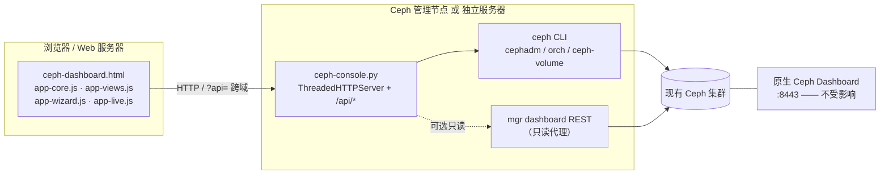

# Ceph Ops Console

面向运维团队的 **Ceph 集群监控告警 + 磁盘运维控制台**。对接**现有**集群，不改动、不占用原生 Ceph Dashboard。

- 兼容 Ceph 12.x ~ 19.x 与主流 Linux，运行时探测能力，不按版本硬编码命令
- Web 上直接**一键踢盘 / 换盘 / 新增盘 / IN 盘**，带告警中心与全量变更审计
- 数据全部来自 Ceph CLI / mgr REST，**没有任何内置演示数据**；取不到就显示 `—` 或「未采集」
- 两种形态：管理节点一体化（推荐）、前后端分离
- 后端只依赖 Python 3.6+ 标准库，前端零 CDN、零构建、可离线

> ⚠️ `--allow-write` 只给**进程**写权限。装完默认仍是 DRY-RUN，必须由 admin 在「系统设置 → 安全策略」输入密码打开总开关才会真正下发；不带 `--allow-write` 则无论开关如何都只生成命令。见[写操作闸门](#写操作闸门)。

---

## 目录

- [架构与兼容性](#架构与兼容性)
- [快速开始](#快速开始)
- [写操作闸门](#写操作闸门)
- [磁盘运维](#磁盘运维)
- [创建存储池](#创建存储池)
- [告警中心](#告警中心)
- [主机 CPU / 内存](#主机-cpu--内存)
- [登录与密码](#登录与密码)
- [配置与文件位置](#配置与文件位置)
- [后端 API](#后端-api)
- [部署参数（deploy.sh）](#部署参数deploysh)
- [运维与升级](#运维与升级)
- [排查](#排查)
- [卸载](#卸载)
- [附录：界面数值来源](#附录界面数值来源)
- [目录结构](#目录结构)

---

## 架构与兼容性



前端是静态文件，可同源托管也可放任意 Web 服务器（`?api=` 指后端）；后端默认监听 `0.0.0.0:8780`；两条数据通道：`cli`（完整，需 CLI + keyring）、`rest`（只读，不支持写）。

| 维度 | 范围 |
| --- | --- |
| Ceph | 12.x Luminous ~ 19.x Squid，运行时能力探测 |
| OSD 管理 | `cephadm / orch`、`ceph-volume`、`ceph-disk` 自动选择；含 `ok-to-stop`、`safe-to-destroy` |
| Linux | RHEL / CentOS 7-9、Rocky / Alma、Fedora、Ubuntu / Debian、openEuler、Kylin V10 / UOS、SUSE |
| 初始化系统 | systemd（主）/ SysVinit（回退） |
| 防火墙 | firewalld / ufw / iptables，可 `--no-firewall` 跳过；SELinux 仅提示 |
| 运行时 | Python 3.6+ 标准库，无 pip、无编译、无需联网 |
| 浏览器 | 现代浏览器（原生 JS / SVG，无构建、无 CDN） |

> 后端仅面向 Linux。页面由后端托管时先登录，admin 登录后直接进入真实数据视图（顶栏 `LIVE · 集群 <fsid 前 8 位>`）。用 `file://` 双击打开只会提示需要后端。

---

## 快速开始

仓库：[cfree970415/ceph-ops-console](https://github.com/cfree970415/ceph-ops-console)，默认端口 8780。
两种形态二选一，从头做到尾即可。命令块标了执行机器，源码统一 clone 到 `~/ceph-ops-console`。

### 形态 A：管理节点一体化（推荐）

页面、API、服务全在【Ceph 节点】一台机器。

```bash
# 【Ceph 节点】
cd ~ && git clone https://github.com/cfree970415/ceph-ops-console.git

cd ~/ceph-ops-console && sudo bash deploy.sh --local \
  --host 192.168.27.134 --allow-write --install
```

```
# 【浏览器】打开
http://192.168.27.134:8780/
```

安装结束会打印访问地址、账号、**初始密码（只显示一次）**、API token 与审计路径。

### 形态 B：前后端分离

后端在【Ceph 节点】，前端在【Web 服务器】，两台都要 clone。

```bash
# 【Ceph 节点】装后端
cd ~ && git clone https://github.com/cfree970415/ceph-ops-console.git

cd ~/ceph-ops-console && sudo bash deploy.sh --local --mode backend \
  --host 192.168.27.134 --allow-write --install
```

```bash
# 【Web 服务器】装前端
cd ~ && git clone https://github.com/cfree970415/ceph-ops-console.git

cd ~/ceph-ops-console && sudo bash deploy.sh --local --mode frontend \
  --backend-url http://192.168.27.134:8780 \
  --cors-origin http://<web-server> \
  --dir /var/www/ceph-console --install
```

```
# 【浏览器】打开（?api= 指向后端）
http://<web-server>/?api=http%3A%2F%2F192.168.27.134%3A8780
```

> 浏览器要能访问【Ceph 节点】的 8780，`--cors-origin` 要放行前端站点。

### 补充

**内网访问不了 GitHub**：在能上网的机器 `git clone` 后 `scp -r ceph-ops-console/ root@<host>:~/`（或下 zip 解压），把命令里的 `~/ceph-ops-console` 换成实际目录。仓库里 6 个运行文件就是全部依赖，不需编译、不需联网装包。

---

## 写操作闸门

踢盘 / 换盘 / 新增盘 / IN 盘 / 建池，**五条同时满足**才真正下发，否则一律 DRY-RUN：返回完整命令、写审计、不改集群。

1. 服务端带 `--allow-write`（`deploy.sh --allow-write` 传入，落在 `/etc/ceph-console/env`）
2. 专用 keyring 有写能力（安装默认 `--keyring full`）
3. 设置页「允许真实写操作」总开关为开 —— **默认关**，开关时需 admin 重新输入自己的密码
4. 登录角色为 `admin`，请求带 `allow_write: true`
5. 二次确认开着时（**默认开**），请求体带正确 `confirm_phrase`（OSD 操作 `osd.<ID>`，建池为池名）

第 1 条是「进程有没有写权限」，第 3 条是「人授权了没有」——只装一次就能动手是不允许的。关掉二次确认仍需第 1~4 条，只是不用手输编号。

### 安全策略的两个开关

| 设置 | 默认 | 含义 |
| --- | --- | --- |
| 允许真实写操作 | **关闭** | 关闭时全程 DRY-RUN，只生成命令 + 写审计 |
| 危险操作二次确认 | **开启** | 踢盘 / 换盘 / 建池前必须手输 `osd.<ID>` 或池名 |

位置：「系统设置 → 安全策略」。点击不立即生效，而是弹窗要求输入**当前登录账号**的密码，后端校验后写入 `config.json`（0600）：

- 只接受 `admin`；`viewer` 与匿名一律 403
- 密码错误按登录失败同样节流（5 次后 429），不能当绕过登录的旁路
- 服务端没有 `--allow-write` 时，打开写开关返回 409 并说明「打开也不会下发」，不制造已开启的假象
- 每次改动记一条 `SECURITY_SETTING` 审计

### 其它防护

- 参数强校验：`osd_id` 强制整数、`/dev/...` 与主机名走白名单正则
- 所有外部命令以 argv 数组调用，不经 shell
- 静态文件仅允许 `^[A-Za-z0-9._-]+$` 且限制在安装目录内，防目录穿越
- 密码 PBKDF2-SHA256（120000 轮 + salt），用户库 0600；会话 Cookie HttpOnly + SameSite
- CORS 可收敛到指定来源，支持 `X-Console-Token` 服务鉴权

---

## 磁盘运维

入口：「OSD / 磁盘」页（行内按钮、OSD 详情弹窗、快捷运维）与概览页「快捷运维」——告警页不放处置按钮。

### 一键踢盘（停服务 + DOWN + OUT，不退役）

```
停止 OSD 守护进程 → 标记 DOWN → 标记 OUT → 健康验证 → 回读 osd dump 复核
```

**为什么先停服务**：`ceph osd down` 只改 osdmap 标记，守护进程还活着时心跳会在几秒内把它改回 `up`——这就是「踢完只剩 out、down 没生效」的原因。所以先停进程（cephadm `ceph orch daemon stop osd.<id>`；包安装 `systemctl stop ceph-osd@<id>`），再 `osd down`，最后 `osd out` 触发回填。

执行后回读 `ceph osd dump` 复核 `up=false / in=false`；不通过（例如权限不足没停掉服务）会显示「未完全生效」并给出手工命令，不假装成功。到此为止：**不执行** `purge` / `crush remove` / `auth del` / `lvm zap`，OSD 身份与盘上数据都保留，之后点 IN 即可加回。

需要永久下线时走「换盘向导」的 `remove` 意图（完整退役，含 purge 与清盘），那条路径不可逆。

### 换盘（两步 · OSD 编号不变）

现场物理换盘是人工动作，可能隔几小时甚至几天，页面随时会被关掉。所以从 1.1.22 起拆成**两个互不依赖的按钮**，各自独立发起请求、各自复核，不靠 `pre/pause` 会话把后半段挂在前半段上。

| 步骤 | 时机 | 平台做什么 | 完成标志 |
| --- | --- | --- | --- |
| **① 换盘前·清退** | 坏盘还在机器上 | 只读确认 OSD 确实 down → `ceph osd out` → `ceph orch osd rm <id> --replace [--force]` 保留编号 → 等移除队列 → 回读 `ceph osd dump` | `osds[]` 里 `osd.<id>` 的 `state` 含 `destroyed` |
| — 现场换盘 — | 人工 | 按 SN / 盘位换上同规格新盘，装回原盘位 | — |
| **② 换盘后·入群** | 新盘已装好 | 校验 destroyed / managed OSDSpec / 新盘归属 → `ceph orch device zap` → OSDSpec 用原编号重建 → 回读 up/in 与健康 | `osd.<id>` up/in，没有多出新编号 |

① 的弹窗**不需要选新盘**（此时新盘还没装）；② 的下拉只列该服务器上未被其它 OSD 占用的设备，**原盘位路径排第一**，带旧 LVM 签名的盘标「需先清理」。两个按钮的确认短语都是 `osd.<id>`——要保住的是编号。「高级向导」保留完整流程预览（① + 人工 + ②），仅供看命令。

**① 清退的硬门禁**：OSD 必须确实 down。后端在真实执行前回读 `ceph osd dump`，仍是 `up` 就 **409 拒绝**——把健康盘清退掉等于自己制造故障。先停服务 / 用「一键踢盘」让它 down。只读预检结果直接显示在弹窗里；已是 `destroyed` 时幂等跳过，直接进 ②。

**② 入群的硬门禁**：点执行时重新只读核验三项，任一不满足就 **409 拒绝 zap**，绝不让新盘变成新增 OSD：

| 前提 | 为什么 |
| --- | --- |
| `osd.<id>` 的 state 含 `destroyed` | `orch osd rm --replace` 是异步的，队列卡在 `done, waiting for purge` 时编号仍是 `exists`，此时 zap 一定分配新编号 |
| 存在非 `unmanaged` 的 OSDSpec | 没有 managed spec，zap 后没有任何服务会来重建 daemon |
| 目标盘不属于别的编号，且 osdmap 里没有 `state=new` 的多余编号 | 防止抹掉别人的盘，也防止在已有残留新 OSD 的情况下继续叠加 |

命令骨架（cephadm）：

```bash
# ① 换盘前·清退
ceph osd tree                              # 人眼确认 up=0
ceph osd out <id>
ceph orch osd rm <id> --replace [--force]
ceph orch osd rm status                    # 移除队列必须真正走完
ceph osd dump --format=json                # state 含 destroyed 才算完成

# --- 现场按 SN / 盘位换盘 ---

# ② 换盘后·入群
ceph orch ls --service-type osd            # 必须存在 managed OSDSpec
ceph orch device zap <host> <dev> --force  # 触发按原编号重建
ceph orch ps --daemon-type osd
ceph osd dump --format=json                # osd.<id> up/in
ceph -s
```

- **不能用 `ceph orch daemon add osd`**：那是命令式添加，会给新盘分配**新编号**，把 1:1 换盘变成「新加了一块盘」，原 OSD 仍以 down/out 留在 osdmap 里。编号复用的唯一机制是 `--replace` 留下的 `destroyed` 标记 + OSDSpec 自动部署。
- cephadm 分支**不手工 `orch daemon stop`**：官方 `--replace` 由编排器自己停 daemon 并 purge，手工停会让移除队列卡在 `done, waiting for purge`。
- 被拒绝时排查：`ceph orch osd rm status` 里若有别的 OSD 卡在 `draining`，先 `ceph orch osd rm stop <id>` 清掉，再重新执行 ①；等 `ceph osd dump` 显示 `destroyed` 后再点 ②。
- 包安装部署没有编排器：① `osd purge`（或 crush remove + auth del + osd rm）把编号从 osdmap 移除，② `ceph-volume lvm zap <dev> --destroy` → `ceph-volume lvm create --data <dev> --osd-id <id>` 显式复用编号，不依赖 `destroyed`。两步是独立请求，② 读不到 ① 之前的 CRUSH 权重；原权重非 1.0 时手工补 `ceph osd crush reweight osd.<id> <原权重>`。

两个阶段用各自的复核尺子：① 看「编号是否安全释放」，② 看「原编号有没有真的回来」。② 的复核按「新盘现在属于谁 + osdmap 有没有多出新编号」分流：

| 结论 | 页面 | 处理 |
| --- | --- | --- |
| 新盘挂回 `osd.<id>` 且 up/in | 绿色「编号不变」 | 完成 |
| 新盘挂回原编号、守护进程还没 up | 黄色「等待编排器重建」 | 部署延迟，不是失败：每 5 秒只读复核一次（最多 12 次），可手动点「重新复核」 |
| ① 已 down/out 但队列还没把编号打成 destroyed | 黄色「等待编号释放」 | 异步收尾，不是失败，可手动点「重新复核」 |
| 新盘被分到**别的编号**，或 osdmap 出现 `state=new` 的多余编号 | 红色「未复用原编号」 | 真失败：旧 OSD 的 metadata 可能仍把新盘报给原编号，别被误导成「启动慢」；清理多出的 OSD、检查 OSDSpec 与移除队列后重试 |

只读复核接口 `POST /api/osd/verify`（`osd_id` + `dev` + `phase=retire|deploy`），不重跑流程、不下发写命令。若本意是**扩容**，请用下一节的「新增磁盘」入口，它才分配新编号。

### 新增磁盘（扩容 · 分配新编号）

```
预检设备（空闲 / 可加入）→ 清理旧元数据 → 创建 OSD（新编号）→ 等待上线 → 健康验证
```

选一块**空闲盘**（`ceph orch device ls` 中 available，也可手填 `/dev/sdX`），清掉分区表 / LVM / 文件系统签名后创建 OSD 并加入 CRUSH。不碰任何已有 OSD。

- cephadm：`ceph orch device zap <host> <dev> --force` → `ceph orch daemon add osd <host>:<dev>`
- 包安装：`ceph-volume lvm zap <dev> --destroy` → `ceph-volume lvm create --data <dev>`
- 安全闸：执行前比对现有 OSD 设备名，已被占用直接拒绝（zap 不可逆）；前端还要输入设备路径确认

### 一键 IN 盘（维护结束 / 误 out 后恢复）

```
启动 OSD 守护进程 → 确认仍在 CRUSH → ceph osd in <id> → 确认 up/in → 健康验证
```

因为踢盘停过服务，IN 会先尝试启动守护进程（`orch daemon start` / `systemctl start`），否则 `osd in` 只恢复权重、状态仍是 down。已被 `purge` / `osd rm` 的 OSD 无法 IN，只能重新部署。

IN 只清「被标记 OUT」类告警，硬件类（SMART、心跳丢失）仍保留，不会假装磁盘修好。

列表行内按钮是二态的：`in` 时显示 **OUT**，`out` 后同位置显示 **IN**，点击直接执行，不再走向导。状态以 `ceph osd dump` 为准，成功后立即丢弃状态缓存并强制刷新（DRY-RUN 未下发时按钮不变，只提示命令未执行）。

> 换盘是「① 清退 → 现场人工换盘 → ② 新盘入群」两个独立请求，**不会假装自动完成物理换盘**；高级向导仍用 `stage=pre` / `stage=post` 展示完整命令序列。

---

## 创建存储池

入口：「存储池」页右上角（列表为空时表格里也有）。

```
填参数 → 生成命令预览 → 输入池名确认 → 执行 → 回读 pool ls detail 复核
```

- **replicated**：指定 `size` / `min_size`，常规业务首选
- **erasure**：选已有 EC profile（显示 `k` / `m` 与可容忍故障盘数），`size` 由 `k+m` 决定，**不允许单独设**

```bash
ceph osd pool create <name> <pg_num> <pgp_num> replicated [<crush_rule>]
ceph osd pool set <name> size 3
ceph osd pool set <name> min_size 2
ceph osd pool set <name> pg_autoscale_mode on      # 14.x+，老版本失败不中断
ceph osd pool application enable <name> rbd        # rbd / cephfs / rgw，可选
ceph osd pool ls detail --format=json              # 复核
ceph -s --format=json
```

EC 池把第二行换成 `... erasure <ec_profile>` 并跳过 `set size`。

- **参数来源**：CRUSH rule / EC profile / OSD 数全部读自集群（`ceph osd crush rule ls` / `ceph osd erasure-code-profile ls|get` / `ceph osd ls`），取不到就不给建议值；PG 建议值按「OSD 数 × 100 ÷ 3」向上取 2 的幂，**只是建议**
- **挡重名**：后端先 `ceph osd pool ls` 比对，同名直接 400（前端预览也标红禁用）
- **校验**：池名 `^[A-Za-z0-9][A-Za-z0-9._-]{0,63}$`、不能以 `.` 开头（Ceph 保留 `.mgr` / `.rgw.root`）、`size` 1~10、`min_size` ≤ `size`、`pg_num` 1~65536、应用类型白名单
- **复核才算成功**：回读 `pool ls detail`，池必须出现且 `size / min_size / pg_num` 与提交一致，否则显示「命令已下发，但复核未通过」并附回读结果
- 只新增池与 PG，**不迁移、不删除**现有数据；`cephfs` 标记只是打标签，文件系统仍需 `ceph fs new`

---

## 告警中心

- 严重 / 警告 / 提示 / 静默四级统计与筛选，支持确认、静音（默认 60 分钟，到期自动恢复）、重新激活，操作写审计
- 每条告警带出关联的 **OSD 编号、主机名、设备盘符**
- 确认 / 静音只改控制台侧状态，不向集群下发任何命令；处置入口统一在「OSD / 磁盘」页

### 同一条告警只算一条

`ceph health detail` 是**当前状态快照**，每 20 秒重算。控制台按 health check code（`OSD_DOWN` / `PG_DEGRADED`…）归并，并自己维护生命周期：

| 字段 | 含义 |
| --- | --- |
| 首次发现 | 本次发作**第一次**被看到的时间，刷新不会重置 |
| 触发次数 | 恢复后再次发作才 +1，持续存在不累加 |
| 状态 | `active` → 确认 `acked` / 静音 `silenced` → 消失后 `resolved` |

- 确认 / 静音状态存后端 `alerts.json`（`/var/lib/ceph-console/alerts.json`，0600），**刷新、换浏览器、重启服务都不会被打回未处置**
- 已确认 / 已静音的不再出现在概览，也不计侧栏角标，只在告警中心按状态查看
- 健康检查消失后，经「次数 + 时间 + 观察期」三重确认才标「已恢复」，保留 2 小时可回溯，之后自动清出
- 静音到期自动回到 `active`，不需人工再点

### 什么时候才算「真的没有告警」

踢盘 / 切盘时 MON 常忙，`ceph health detail` 偶尔超时。**「取不到」不等于「没有告警」**，1.1.16 起：

| 情况 | 行为 |
| --- | --- |
| 命令成功、`checks` 里有这个 check | 正常更新，状态不被重置 |
| 命令失败 / 超时 / 返回体没有 `checks` 字段 | **沿用上一次快照**（标 `alertsOk=false`），不清空、不标恢复 |
| check 消失，但次数 < 2、距最后出现 < 60 秒、或写操作后 3 分钟内 | 保持原状态，标「核实中」，概览仍计入 |
| 连续 ≥ 2 次采集都缺席 **且** 距最后出现 ≥ 60 秒 **且** 不在观察期 | 才标「已恢复」 |

只看次数不够。`osd in` 之后 Ceph 往往要几十秒才开始报 `PG_DEGRADED`，这段窗口里 `ceph status` 已经是 `HEALTH_OK`、`health detail` 也是空的——按「连续 2 次」判，两轮刷新（40 秒）就能把告警刷成已恢复，看起来像「IN 一下就把告警治好了」。所以 1.1.17 加了三道闸：

- **次数**：至少 2 次采集缺席
- **时间**：距最后一次看到这条 check 至少 60 秒
- **观察期**：真实写操作（`in` / `out` / `kick` / `replace` / `init`）后 **3 分钟**内一律不判恢复，原状态照旧

不满足时告警行标「核实中 · 剩余秒数」，顶栏与概览 KPI 显示 **`HEALTH_OK?`**（黄色，「N 项告警待核实」），概览里的活跃告警数也不清零。等观察期结束、Ceph 持续不报这条 check，才转「已恢复」并变绿。

`alertsOk=false`（明细没取到）时同样显示 `HEALTH_OK?`，文案是「健康明细未核实」，告警页顶部另有提示写明实际错误与快照时间。

> 从踢盘 / 换盘恢复到告警消失，现在约 3 分钟。这是故意的：宁可慢，也不要让一次操作把无关告警一起刷绿。

### 定位到具体资源

- 来源是 `health detail` 的 detail 文本（`osd.0 (root=default,host=ceph-single) is down`、`host 'x'`、`host=xxx`、`/dev/nvme0n2`）
- 认出 osd 编号后，用 `osd metadata` 采到的 osd → 主机 / 设备映射补全主机名与盘符
- PG 类告警没有 `osd.N` 字样，退化取 `acting [0,1]` 的 OSD 列表
- 只认出盘符时反查 osd 表拿主机名（`DEVICE_HEALTH` 这类）
- 认不出来的留 `—`，不用推测值填充
- 升级前落盘的旧记录若资产字段为空，下一轮用保存的标题 / 正文重新解析补齐

> 1.1.18 修掉一个只影响 `osd.0` 的解析缺陷：编号 `0` 曾被 Python 的 `if v` 判成假值丢弃，于是单 OSD 集群的告警「涉及 OSD / 主机 / 设备」全显示 `—`。同时补上了 `host=xxx` 这种新版本 Ceph 的文本格式。

### 建议处置（只读）

告警详情里的「建议处置」**只给排查命令**，按 health check code 分流，不直接给 `ceph osd down / out`、zap 或换盘命令：

| 告警类型 | 建议内容 |
| --- | --- |
| `PG_*` / `OBJECT_UNFOUND`（含 `pgs undersized`） | `ceph health detail`、`ceph pg stat`、`ceph osd tree`、`ceph -s`；等回填到 active+clean，明确写明不需要踢盘 |
| `*_FULL` / `NEARFULL` | `ceph df`、`ceph osd df`；清理或扩容，此时 out 会加剧占用 |
| `DEVICE_HEALTH` / SMART | `ceph device ls`、`smartctl -a <dev>`；确认要换后走「① 清退 → 现场换盘 → ② 入群」 |
| `MON_*` / `MGR_*` / `CLOCK_SKEW` | `ceph mon stat`、`quorum_status`、时间同步检查 |
| `SLOW_OPS` / 延迟 | `ceph osd perf`、`ceph osd df` |
| `OSD_DOWN` / 主机 down | **第一条就是 `ceph osd tree`**（确认 up/in、CRUSH 权重、所在主机），再 `ceph osd find <id>`、`ceph osd metadata <id>`、`ceph health detail`、`ceph -s`、查守护进程状态；只是进程掉了先拉服务，不要直接 out |
| 其它 | `ceph osd tree`、`ceph health detail`、`ceph pg stat`、`ceph -s` |

真实写操作统一到「OSD / 磁盘」页或「快捷运维」：那里有二次确认、DRY-RUN 与执行后复核。早前这里只要认出 OSD 编号就一律给出 `down + out` 踢盘步骤，`PG_DEGRADED`（副本不足）也会中招，1.1.18 起改为按类型给只读建议。

`code` 缺失、或资产三列是旧版本落盘的空值时，会退而用告警标题/正文（`osd.0 (root=default,host=ceph-single) is down`）判断类型并解出 `osd.0` / 主机名，命令里填真实编号而不是 `<id>`。识别不出的仍留 `—`，不猜值。

---

## 主机 CPU / 内存

| `--host-metrics` | 行为 |
| --- | --- |
| `auto`（默认） | 控制台所在节点读 `/proc`；其它节点 `ssh` 过去读同一份，读不到就留空 |
| `ssh` | 所有节点都走 ssh（含本机） |
| `off` | 不采集，统一显示「未采集」 |

- 本机读 `/proc/stat`（150ms 差值）+ `/proc/meminfo`，15 秒缓存
- ssh 用 `BatchMode=yes` + `PubkeyAuthentication`，**没有免密 key 就直接失败**，不会卡在密码提示，也不会改读本机数据冒充；失败 5 分钟内不重试
- cephadm bootstrap 节点本来就有到各主机的免密 key，控制台以 root 运行即可复用；否则用 `--host-ssh-user` 指定
- 远端只执行一条**固定常量**命令，主机名来自 `ceph orch host ls` 且过白名单正则，不拼用户输入
- 要长期监控整集群，仍建议 node_exporter + Prometheus：ssh 采样是「有几台看几台」的轻量方案，不做历史聚合

> `--host-metrics` / `--host-ssh-user` 是 `ceph-console.py` 自身的参数，`deploy.sh` **不会转发**。要改就在服务启动命令末尾追加：`sudo systemctl edit --full ceph-console`，在 `ExecStart` 行末加 `--host-metrics off`，再 `systemctl restart ceph-console`。

> 顶栏集群标识用 `fsid` 前 8 位（Ceph 没有"集群名"字段），不显示任何虚构名称。

---

## 登录与密码

| 项 | 说明 |
| --- | --- |
| 账号存储 | `/etc/ceph-console/users.json`（0600），只存 PBKDF2-SHA256 哈希 |
| 初始账号 | `--user`（默认 `admin`）；密码由 `--password` 或 `CEPH_CONSOLE_PASSWORD` 指定，否则自动生成并**只打印一次** |
| 会话 | HttpOnly + SameSite Cookie + `X-Console-Session`，默认 8 小时（`--session-ttl`） |
| 服务 token | `X-Console-Token`，用于脚本 / 健康检查，存 `/etc/ceph-console/env`（0600） |
| 角色 | `admin` 可真实执行；`viewer` 可查看与 DRY-RUN 演练，真实执行 403 |
| 登录保护 | 300 秒窗口内 5 次失败后限速 |
| CORS | `--cors-origin` 限制来源，默认 `*` |

> `--no-auth` 可关登录，**不推荐**：任何能访问该端口的人都能读集群数据。

### 改密码

**页面**（日常用这个）：登录 → 系统设置 →「账号与密码」→ 填当前 / 新 / 确认 → 提交。支持所有本地账号，改的是自己。

- 新密码 8~128 位、不能与当前相同、不能带首尾空白
- 当前密码输错也计入登录限速（300 秒 5 次）
- 原子写 `users.json`，明文不落盘、不进日志、不出现在接口返回
- 成功后**同账号其它会话立即失效**，当前会话保持；审计记 `PASSWORD_CHANGE`
- 仅持 `X-Console-Token` 的服务令牌不能改密

**忘记密码 / 账号被锁**（无需登录、无需重启）：

```bash
# 【Ceph 节点】
sudo python3 ~/ceph-ops-console/ceph-console.py \
  --set-password admin --users-file /etc/ceph-console/users.json
```

脚本会不回显地提示输入两次。脚本化场景可用 `CEPH_CONSOLE_NEW_PASSWORD` 环境变量传入（明文会留在 shell 历史，用完清理）。

- 后端每次登录都重读 `users.json`，改完无需重启；要踢掉所有已登录会话 `systemctl restart ceph-console`
- 重跑 `deploy.sh --install` **不带** `--password` 会保留现有用户库（含新增账号），只有显式传 `--password` 才重置

---

## 配置与文件位置

> 以下均指 **【Ceph 节点】** 本机。形态 B 的【Web 服务器】上只有 `--dir` 指定的静态目录，没有配置、用户库、keyring、审计。

| 用途 | 路径 |
| --- | --- |
| 安装目录 | `/opt/ceph-console`（`--dir` 可改） |
| 配置文件 | `/etc/ceph-console/config.json`（告警阈值 + `allow_write` / `confirm`，0600；`--config-file` 可改） |
| 告警状态 | `/var/lib/ceph-console/alerts.json`（0600） |
| 用户库 | `/etc/ceph-console/users.json`（0600） |
| 服务 token | `/etc/ceph-console/env`（0600） |
| 专用 keyring | `/etc/ceph/ceph.client.ceph-console.keyring` |
| 审计日志 | `/var/log/ceph-console/audit.jsonl` |
| 运行日志 | `journalctl -u ceph-console -f`（SysVinit 为 `/var/log/ceph-console/console.log`） |
| systemd 服务 | `ceph-console.service` |

配置文件示例：

```json
{"nearfull": 85, "full": 95, "downMin": 10, "allow_write": false, "confirm": true}
```

---

## 后端 API

除 `/api/session`、`/api/login`、`/api/logout` 外，`/api/*` 均需会话或 token。

| 方法 | 路径 | 说明 |
| --- | --- | --- |
| GET | `/api/session` | 会话、角色、`allow_write`（实际可写）、`write_capability`（进程能力） |
| POST | `/api/login` `/api/logout` | 登录 / 登出 |
| POST | `/api/password` | 改密码：会话 + `old_password` + `new_password` + `confirm_password` |
| POST | `/api/security` | 改安全策略（admin + 密码复核） |
| GET | `/api/state` | 集群实时状态（20 秒缓存，`?refresh=1` 跳过） |
| GET | `/api/history?hours=24` | 真实容量 / IOPS 采样（60 秒一点，保留 24h） |
| GET | `/api/probe` | 版本 / 编排器 / 能力探测 |
| GET | `/api/diag` | 自检：`ceph status` 命令 / 退出码 / stderr、路径、keyring、能力，**不含凭据** |
| GET | `/api/plan` `POST /api/plan` | 可用能力 / 生成命令序列 |
| GET | `/api/progress` | 回填与任务进度 |
| GET | `/api/isolation` | 原生 Dashboard 隔离自检 |
| GET | `/api/audit` | 审计记录 |
| GET | `/api/devices` | 各主机磁盘清单与 available 标记 |
| GET | `/api/osd/<id>/meta` | OSD 元数据 |
| POST | `/api/quick/kick` | 踢盘（停服务 + down + out，返回 `verify`） |
| POST | `/api/quick/in` | IN 盘（启服务 + in + 回填观察） |
| POST | `/api/quick/init` | 新增磁盘（zap + 创建，新编号） |
| POST | `/api/quick/retire` | ① 换盘前·清退：校验 OSD 确实 down → `--replace` 保留编号 → 复核 `destroyed` |
| POST | `/api/quick/deploy` | ② 换盘后·新盘入群：destroyed / OSDSpec 硬门禁 → zap → 复核原编号 up/in |
| POST | `/api/osd/verify` | 只读复核：`osd_id` + `dev` + `phase=retire\|deploy`，不重跑流程 |
| POST | `/api/quick/replace` | 高级向导的完整流程（`stage=pre` / `stage=post`） |
| POST | `/api/execute` | 高级向导执行 |
| GET | `/api/pool/options` | 建池下拉项：OSD 数、池名、CRUSH rule、EC profile、PG 建议 |
| POST | `/api/pool/plan` `/api/pool/create` | 建池预览 / 创建（`confirm_phrase` = 池名） |
| POST | `/api/osd/<id>/out` `/in` | 标记 out / in |
| POST | `/api/alert/ack` | 告警确认 / 静音 / 恢复（`action` = ack / silence / reopen / resolve） |
| OPTIONS | `/api/*` | CORS 预检 |

```bash
curl -H "X-Console-Token: <token>" http://192.168.27.134:8780/api/probe
```

---

## 部署参数（deploy.sh）

| 参数 | 默认 | 说明 |
| --- | --- | --- |
| `--install` | 预览 | 真正执行；不加只预览 |
| `--local` | — | 从脚本所在目录读文件 |
| `--mode` | `all` | `all` / `backend` / `frontend` |
| `--host` | — | 访问地址用的 IP 或主机名 |
| `--port` | `8780` | 服务端口 |
| `--dir` | `/opt/ceph-console` | 安装目录 |
| `--keyring` | `full` | 专用账号权限，默认即可 |
| `--allow-write` | 关 | 给进程写权限，**不等于已开启真实执行** |
| `--backend` | `cli` | `cli` 完整 / `rest` 只读代理 |
| `--rest-url` `--rest-token` | — | mgr dashboard REST 通道 |
| `--user` `--password` | `admin` / 自动生成 | 登录账号；密码推荐用 `CEPH_CONSOLE_PASSWORD` |
| `--backend-url` | — | `frontend` 模式写入的后端地址 |
| `--cors-origin` | `*` | 允许的 UI 来源，逗号分隔 |
| `--token` | 自动生成 | 服务 API token |
| `--no-auth` | 关 | 禁用登录（不推荐） |
| `--no-firewall` `--no-service` | 关 | 跳过防火墙 / 服务注册 |
| `--install-deps` | 关 | 尝试安装 python3 / ceph-common |
| `--uninstall` `--purge` | — | 卸载 / 连配置一起删 |

完整帮助：`bash deploy.sh --help`

---

## 运维与升级

```bash
# 【Ceph 节点】
systemctl status ceph-console
systemctl restart ceph-console
journalctl -u ceph-console -f
tail -f /var/log/ceph-console/audit.jsonl
curl -H "X-Console-Token: <token>" http://127.0.0.1:8780/api/state
```

### 升级

`deploy.sh --install` 是把文件**复制**到 `/opt/ceph-console`，之后 `git pull` 只更新 `~/ceph-ops-console`，服务仍读旧文件。**每次拉完代码都要同步一次**。同步只覆盖运行文件，不动 `/etc/ceph-console/` 下的用户库、配置与 token，密码 / API token / 审计都保留；重启后会话失效需重新登录。

```bash
# 【Ceph 节点】后端
cd ~/ceph-ops-console && git pull
sudo install -m 0644 ceph-console.py ceph-dashboard.html \
  app-core.js app-views.js app-wizard.js app-live.js /opt/ceph-console/
sudo systemctl restart ceph-console
```

```bash
# 【Web 服务器】形态 B 前端
cd ~/ceph-ops-console && git pull
sudo install -m 0644 ceph-dashboard.html \
  app-core.js app-views.js app-wizard.js app-live.js /var/www/ceph-console/
sudo cp /var/www/ceph-console/ceph-dashboard.html /var/www/ceph-console/index.html
```

自定义过 `--dir` 就换成实际目录；前端没有服务，不需重启。

确认是否真更新了：

```bash
curl -s http://127.0.0.1:8780/app-core.js | grep -c '1.1.22-20261111'
```

页面里看更直观：**系统设置 → 关于 → 前端构建**，最新为 `1.1.22-20261111`，登录页底部同号。仍是旧号说明浏览器或 nginx 缓存了旧文件，Ctrl+F5。

> 从 1.1.15 起，旧 `config.json` 没有 `allow_write` 时按「关闭」处理：升级后真实写操作会回到 DRY-RUN，需 admin 到设置页输密码重新打开。这是有意的默认值收紧，不是升级失败。

---

## 排查

### 页面显示「集群数据未就绪」

不是演示数据，是后端没取到集群状态。拿不到有效的 `/api/state` 时，概览 / 告警 / OSD / 存储池 / 主机统一显示诊断页，**不渲染任何数值**：顶栏 `LIVE · 等待后端数据`，健康 `UNKNOWN`，角标归零。

诊断页列出失败原因、后端地址、账号、构建号与最近尝试时间，并提供「重新同步」与「运行后端自检」（调 `/api/diag`，显示 `ceph status` 的实际命令、退出码、stderr、可执行文件位置、keyring 状态与能力探测）。该端点只读，不返回 keyring 内容、token、密码或会话 id。

| 自检结果 | 原因 | 处理 |
| --- | --- | --- |
| `ceph 未在 PATH 中找到` | 没装 `ceph-common`，或 systemd 的 PATH 与登录 shell 不同 | 装 `ceph-common`；查 `systemctl cat ceph-console` 的环境 |
| `ceph status 失败`，stderr 含 `ENOENT` / 连接超时 | 无 `/etc/ceph/ceph.conf`、集群不可达，或后端不在管理节点 | 部署到能跑通 `ceph -s` 的节点 |
| `keyring 不存在` / `permission denied` | keyring 丢失、权限不对、服务用户读不到 | `ls -l` 后 `chmod 0600`，必要时重跑安装 |
| stderr 含 `access denied` / caps 不足 | 早期 `readonly` 安装遗留 | `ceph auth caps client.ceph-console mon 'allow rwx' osd 'allow rwx' mgr 'allow rwx'` |
| `HTTP 401` / `not authenticated` | 会话过期（重启后会话在内存里） | 重新登录 |
| 请求未完成（网络 / CORS） | 形态 B 的 `?api=` 不对，或 `--cors-origin` 没放行 | 核对后端地址与来源配置，8780 需对浏览器可达 |
| 自检全通过但页面无数据 | 20 秒缓存或浏览器缓存了旧 JS | 点「重新同步」，`systemctl restart`，Ctrl+F5 |

```bash
systemctl status ceph-console --no-pager
ceph -s
ceph auth get client.ceph-console
ls -l /etc/ceph/ceph.client.ceph-console.keyring
curl -H "X-Console-Token: <token>" http://127.0.0.1:8780/api/diag | python3 -m json.tool
journalctl -u ceph-console -n 50 --no-pager
```

> 这台机器上**本来就没有 Ceph 集群**时，`/api/state` 永远不会有真实状态，这是预期结果。1.0.7 起没有离线演示模式。

### 常见问题

**页面还是旧数据 / 空白？** 先看构建号（设置 → 关于，或登录页底部），不是 `1.1.22-20261111` 就是运行目录还是旧文件；号对但页面空则属于上一条，点自检看真实报错。

**换完盘多出一块 OSD，原编号还是 down/out？** 两种成因：

1. **1.1.19 及以前**：换盘用了 `ceph orch daemon add osd`，给新盘分配了新编号，旧编号以 down/out 留在 osdmap；1.1.20 起已删除这条命令。
2. **1.1.20**：`ceph orch osd rm --replace` 是异步的，移除队列还没走完（常卡在 `done, waiting for purge`）就 zap 了新盘，原编号仍是 `exists` 而不是 `destroyed`，编排器于是把新盘当成全新盘部署。

1.1.21 起 zap 之前有硬门禁，三项前提任一不满足就 409 拒绝；复核也会识别 `state=new` 的多余编号，不再把旧 metadata 误导判成「up 慢」。1.1.22 起进一步把换盘拆成「① 清退 / ② 入群」两个独立按钮（见上一节），① 还要求 OSD 确实 down，从流程上就杜绝「一边还在 up 一边把新盘加进来」。已经多出来的盘按下面顺序收尾（**先确认没有不可恢复的数据**）：

```bash
ceph osd tree; ceph osd dump            # 认出多出的编号（如 osd.2）与原编号的 state
ceph orch osd rm status                 # 有别的 OSD 卡在 draining 时先 ceph orch osd rm stop <id>
ceph orch osd rm 2 --force              # 退役误建的 OSD（不要 zap 还在用的盘）
ceph orch ls --service-type osd         # 确认存在 managed 的 OSDSpec
ceph orch osd rm 0 --replace --force    # 重新预约原编号；等 osd dump 显示 destroyed
```

之后在 OSD 页按两步走：先点 **① 换盘前·清退**（等 `destroyed`），确认队列干净再现场换盘，换好点 **② 换盘后·入群**。两步之间不用保持页面打开。**不要直接 zap 正在被使用的盘**；若只是想扩容，用「新增磁盘」入口即可，不必清理。

**点了一键踢盘，只有 out 没有 down？** `ceph osd down` 只改 osdmap 标记，守护进程还在跑心跳会改回 `up`。1.1.4 起第一步就是停守护进程，执行后回读 `osd dump` 复核。提示「未完全生效」说明停服务失败（多半是后端不是 root，或 orch 未接管），按提示在集群节点手工停一次。

**踢盘了但集群没变化？** 按三层查：① `/api/session` 的 `write_capability` 是否 `true`（服务端有没有 `--allow-write`）；② 同一响应里的 `allow_write` 是否 `true`——它才是设置页总开关的结果，**默认 `false`**；③ 角色是否 `admin`。缺 ① 改 `/etc/ceph-console/env` 的 `CEPH_CONSOLE_ALLOW_WRITE=1` 后重启；缺 ② 去设置页开，无需重启。

**新加的 OSD 看不到？** 列表取 `osd dump` ∪ `osd df` ∪ `osd tree` 三源并集，任一出现就显示（`df` 还没统计的字段显示「未采集」，不会是 0 B）。仍看不到时：

```bash
ceph osd dump --format=json | grep -c '"osd":'   # MON 是否接受
ceph osd tree                                    # 是否挂进 CRUSH
ceph orch ps --daemon-type osd                   # cephadm：daemon 是否还在 creating
```

三种情况：`dump` 没有 → 没创建成功，看 `ceph-volume` / `ceph orch` 报错；只在 `tree` → MON 未接受，通常是启动失败；都有但页面旧 → 20 秒缓存，等一个周期。

**所有盘显示同一个设备名（如都 `/dev/nvme0n1`）？** `ceph device ls` 会把同一 NVMe 控制器下的多个 namespace 报成同一个 device，并把多个 daemon 挂在它名下。控制台以 `ceph osd metadata <id>` 的 `bluestore_bdev` 为准，且某条 `device ls` 记录被多个 OSD 引用时整组丢弃。升级后仍重复就查两点：keyring 是否有 `osd 'allow r'`；OSD 数是否超过 64（超过会跳过逐个核对以免拖慢）。

```bash
ceph osd metadata 0 --format=json | grep -E 'bluestore_bdev|devices'
ceph-volume lvm list --format=json | head -20    # LVM 部署才有内容
```

**OUT 再 IN 之后告警全没了、集群变成 OK？** 正常情况下不会。`in` 之后有 **3 分钟观察期**：这段时间顶栏显示 `HEALTH_OK?`（「N 项告警待核实」），告警行标「核实中」，即使 `ceph status` 已经报 OK 也不变绿；观察期结束、Ceph 持续不报这条 check，才转「已恢复」。如果顶栏显示「健康明细未核实」（`alertsOk=false`），说明这一轮 `ceph health detail` 没读到，列表是上次快照，等下一轮自动恢复。1.1.16 之前命令超时被直接当成「没有告警」，1.1.17 之前则是「连续两次缺席就判恢复」——`in` 后 Ceph 尚未开始报 `PG_DEGRADED` 的那几十秒刚好凑满两次，所以看起来一 IN 就变 OK。

**踢完盘一直 out 怎么恢复？** 点该行 **IN**（或概览「一键 IN 盘」），等价 `ceph osd in <id>`，恢复 CRUSH 权重并开始回填。进程本身起不来（down）需先修硬件或重启 OSD 服务。

**CPU / 内存显示「未采集」？** 悬停给出 ssh 的真实报错：`Permission denied (publickey)` 说明没有免密 key（在 bootstrap 节点运行，或 `ssh-copy-id root@<ip>`）；`Connection timed out` 是 22 端口不通；`本机没有 ssh 客户端` 装 `openssh-client`。不需要就 `--host-metrics off`。

**`rest` 后端为什么不能换盘？** REST 是 mgr dashboard 的只读代理，OSD 写操作需要 `cli` 后端与 ceph CLI。

**端口被占用？** 部署前会检查常用 dashboard 端口，换 `--port` 即可，不会动原生 Dashboard。

---

## 卸载

只清理本程序装在这台机器上的东西：**不动 Ceph 集群数据、不改 `ceph.conf` 与 mgr 模块、不影响原生 Dashboard**，源码仓库也保留。

> 必须加 `sudo`——脚本对权限不足的失败是静默忽略的，不加 sudo 看似成功实际没删干净。

```bash
# 形态 A【Ceph 节点】：保留配置卸载
cd ~/ceph-ops-console && sudo bash deploy.sh --uninstall

# 形态 A【Ceph 节点】：彻底卸载
cd ~/ceph-ops-console && sudo bash deploy.sh --uninstall --purge
```

```bash
# 形态 B【Ceph 节点】后端
cd ~/ceph-ops-console && sudo bash deploy.sh --mode backend --uninstall --purge

# 形态 B【Web 服务器】前端
cd ~/ceph-ops-console && sudo bash deploy.sh --mode frontend --uninstall --no-firewall
```

前端带 `--mode frontend` 会自动定位 `/var/www/ceph-console`。安装时自定义过 `--dir` 或 `--port`，卸载必须带同样的值，否则目录认不出、防火墙规则删不掉。前端安装本就不建服务、不改防火墙，故补 `--no-firewall` 避免误删同名规则。

| 项目 | `--uninstall` | `--purge` |
| --- | --- | --- |
| 停用并删除服务 / systemd unit / init.d 脚本 | 删 | 删 |
| 安装目录（`/opt/ceph-console` 或 `/var/www/ceph-console`） | 删 | 删 |
| 防火墙 `8780/tcp` 规则 | 删 | 删 |
| `/etc/ceph-console/`（config / users / env） | 保留 | 删 |
| `/var/log/ceph-console/`（含审计） | 保留 | 删 |
| `/etc/ceph/ceph.client.ceph-console.keyring` | 保留 | 删 |

需要手动处理的：

- **集群里的 `client.ceph-console` 账号**：脚本只删本机 keyring，不执行 `ceph auth del`。确定不再用可手工 `ceph auth del client.ceph-console`（提前删反而能避免重装时 caps 不匹配）
- **形态 B 的 nginx / Apache 站点配置**：脚本只删静态目录
- **`~/ceph-ops-console`**：保留，供重装升级

校验：`systemctl status ceph-console` 应找不到服务，`ls /opt/ceph-console` 应不存在。

---

## 附录：界面数值来源

**没有任何写死的业务数字**，每个值都能追到一条命令；后端没给的一律 `—` 或「未采集」。

| 界面 / 字段 | 来源 | 取不到时 |
| --- | --- | --- |
| 概览：健康、容量、OSD up/in、告警数 | `ceph status`（`health` / `osdmap` / `pgmap`）+ 告警规则 | 整页诊断页 |
| 概览：PG 总数、active+clean、degraded、MON 法定人数、池数 | `pgmap.num_pgs`、`pgmap.pgs_by_state`、`ceph quorum_status`（缺失回落 `ceph mon dump`，最后才用 `status.monmap`）、`ceph osd pool ls detail` | `—` |
| 概览：容量 / IOPS 趋势 | `/api/history`（每 60 秒真实采样，落盘 24h） | 「暂无真实历史数据」 |
| 存储池：清单 / 类型 / size / min_size / PG / 应用 | `ceph osd pool ls detail`（`pg_num` / `pgp_num` / `type` / `application_metadata` 都在这；`ceph df detail` 的池条目**没有** PG 与 application 字段） | `—` |
| 存储池：用量 / 水位 | `ceph df detail` 的 `stats.bytes_used` / `max_avail`（物理口径含副本冗余；逻辑写入看 `stats.stored`，悬停可见） | 「未采集」 |
| 存储池：回填 PG、恢复 / 增长速率 | `pgmap` 实时 + 24h 采样 | `—` / 「累积中」 |
| 主机：主机名、地址、MON / MGR 角色、leader、active | `ceph osd tree`（按 `status` 统计 up）+ `ceph orch host ls` + `ceph quorum_status`（成员 / 地址 / leader）+ `ceph mgr dump`（active / standby）。`ceph status` 的 `monmap` 从 Octopus 起只有 `num_mons`，**不能**取成员名 | `—` |
| OSD 列表成员 | `ceph osd dump` 的 `osds[]` ∪ `ceph osd df` ∪ `ceph osd tree`，三源并集（新 OSD 往往先进 dump / tree，最后才进 df） | 至少 `tree` 能列出即显示 |
| OSD：容量、使用率、PG 数 | `ceph osd df`（按 id 匹配） | `—` |
| OSD：up / in | `ceph osd dump` 的 `osds[].up` / `[].in`（失败回落 `osd tree` 的 `status` / `reweight`） | `—` |
| OSD：设备名 | `ceph osd metadata <id>` 的 `bluestore_bdev`（**唯一按 osd 查自身设备**的来源，cephadm raw 部署下只有它能看到 nvme namespace）→ `ceph-volume lvm list` → `ceph device ls`（仅采信一对一记录） | `未采集` |
| OSD：序列号 | `ceph device ls` 的 `device_id`，仅设备名与该 OSD 匹配时采纳 | `未采集` |
| OSD：SMART | 需 cephadm / Prometheus 侧盘健康指标，**不伪造 OK** | `未采集` |
| 主机：CPU / 内存 | 本机读 `/proc/stat`、`/proc/meminfo`；其它节点 `ssh` 执行同一只读命令，15 秒一次，失败 5 分钟内不重试 | 该行「未采集」，悬停看 ssh 报错 |
| 变更审计 | `/var/log/ceph-console/audit.jsonl`（时间、用户、目标、命令、DRY-RUN / EXECUTED / REJECTED、来源 IP） | 空列表 |
| 告警阈值 nearfull / full | `config.json`，随 `/api/state` 下发 | 默认 85 / 95 |
| 安全策略 allow_write / confirm | `config.json`，改动走 `POST /api/security` 并写审计 | `false` / `true` |

---

## 目录结构

`deploy.sh` 把其中 6 个运行文件复制到安装目录，仓库本身留在 `~/ceph-ops-console` 供升级、重装、卸载使用。

```
.
├── README.md                 # 本文档
├── .gitignore                # 排除凭据与运行数据
├── .gitattributes            # 强制 LF（deploy.sh 必须 LF）
├── deploy.sh                 # 一键部署 / 卸载脚本
├── ceph-console.py           # 后端：静态托管 + /api/* + 能力探测与执行
├── ceph-dashboard.html       # 页面骨架与样式
├── app-core.js               # 状态、API 客户端、图表、概览与顶栏
├── app-views.js              # 告警 / OSD / 存储池 / 主机 / 审计 / 部署 / 设置
├── app-wizard.js             # 高级 5 步向导、弹窗与事件绑定
└── app-live.js               # 登录、跨机后端连接、踢盘 / 换盘 / IN 盘
```

## 说明

- `users.json`、`config.json`、`env`、`alerts.json`、`audit.jsonl`、`*.keyring` 已由 `.gitignore` 排除，**切勿提交**
- 许可证未声明，公开发布前请补 `LICENSE`
