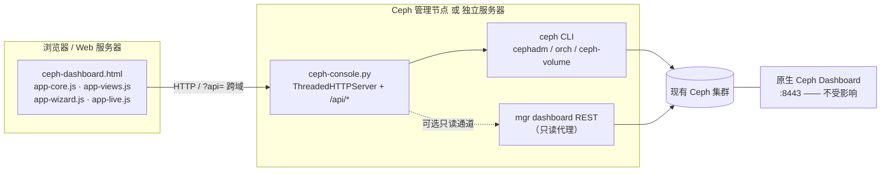

# Ceph Ops Console

面向运维团队的 **Ceph 集群监控告警 + 磁盘运维控制台**。

- 兼容 Ceph 12.x ~ 19.x 与主流 Linux 发行版，一键部署并对接**现有**集群；
- Web 页面直接 **一键踢盘 / 一键换盘**，带告警中心与变更审计；
- 真实后端（Ceph CLI / mgr Dashboard REST），不是演示数据；
- **完全不改动、不占用原生 Ceph Dashboard**；
- 支持「管理节点一体化启动」和「前端与后端分离部署」两种形态；
- 后端仅依赖 Python 3.6+ 标准库，前端零 CDN、零构建、可离线运行。

> ⚠️ 所有写操作默认 **DRY-RUN**：只生成命令并写入审计，不会下发到集群。
> 真实执行必须显式开启，详见 [一键踢盘 / 一键换盘](#一键踢盘--一键换盘)。

---

## 目录

- [核心能力](#核心能力)
- [架构](#架构)
- [兼容性](#兼容性)
- [快速开始](#快速开始)
- [登录与权限](#登录与权限)
- [一键踢盘 / 一键换盘](#一键踢盘--一键换盘)
- [告警中心](#告警中心)
- [与原生 Ceph Dashboard 的隔离](#与原生-ceph-dashboard-的隔离)
- [安全设计](#安全设计)
- [配置与文件位置](#配置与文件位置)
- [后端 API](#后端-api)
- [部署参数速查](#部署参数速查)
- [常用运维](#常用运维)
- [常见问题](#常见问题)
- [目录结构](#目录结构)

---

## 核心能力

| 能力 | 说明 |
| --- | --- |
| 集群概览 | HEALTH 状态、OSD 上下线、容量与 PG 状态、活跃告警、待处置故障盘、SVG 趋势图 |
| 告警中心 | 四级告警分级统计、筛选/确认/静默、告警直达故障 OSD 的一键处置入口 |
| OSD / 磁盘 | OSD 列表、主机与设备映射、元数据查询、标记 out / in |
| 存储池 / 主机 | 存储池用量、主机与 MON 视图 |
| 一键踢盘 | 标记 OUT → 等待回填 → 移除 OSD 与认证 → 清理设备 → 健康验证 |
| 一键换盘 | 移除 OSD → 清理元数据 → **暂停等待人工换盘** → 原 OSD ID 重建 → 回填观察 |
| 高级向导 | 5 步流程，逐步展示命令、预检项与执行结果 |
| 变更审计 | jsonl 全量记录（时间、用户、目标、命令、DRY-RUN / EXECUTED / REJECTED、来源 IP） |
| 部署与对接 | 页面内展示部署模式、原生 Dashboard 隔离自检、后端地址与登录态 |
| 登录 | 账号密码登录、admin / viewer 角色、会话过期、失败限速 |
| 主题 | 深色 / 浅色切换，纯前端实现 |

---

## 架构



- **前端**：静态文件，可由后端同源托管，也可放在任意 Web 服务器（Nginx / Apache），通过 `?api=<后端地址>` 指向后端。
- **后端**：`ceph-console.py`，同时提供静态文件与 `/api/*`，默认监听 `0.0.0.0:8780`。
- **两种数据通道**：`cli`（完整能力，需要 ceph CLI 与 keyring）/ `rest`（只读取 mgr dashboard API，不支持写操作）。

---

## 兼容性

| 维度 | 支持范围 |
| --- | --- |
| Ceph | 12.x Luminous ~ 19.x Squid（**运行时能力探测**，不按版本硬编码命令） |
| OSD 管理 | `cephadm / ceph orch`、`ceph-volume`、`ceph-disk` 自动选择；含 `ok-to-stop`、`safe-to-destroy` 检查 |
| Linux | RHEL / CentOS 7-9、Rocky / AlmaLinux、Fedora、Ubuntu / Debian、openEuler、Kylin V10 / UOS、SUSE，及通用 systemd / SysVinit 主机 |
| 初始化系统 | systemd（主）/ SysVinit（回退） |
| 防火墙 | firewalld / ufw / iptables，可 `--no-firewall` 跳过；SELinux 会给出提示 |
| 运行时 | Python **3.6+ 标准库**，无 pip 包、无编译、无需联网 |
| 浏览器 | 现代浏览器（原生 ES5+ JS / SVG，无需构建、无 CDN 依赖） |

> 后端仅面向 Linux 部署。直接双击 `ceph-dashboard.html` 会进入 **DEMO 模式**（本地模拟数据，供界面预览，不连接集群）。

---

## 快速开始

### 0. 准备文件

把以下 7 个文件放到目标 Linux 主机同一目录（例如 `/tmp/ceph-console/`）：

```bash
scp ceph-console.py ceph-dashboard.html \
    app-core.js app-views.js app-wizard.js app-live.js deploy.sh \
    root@<ceph-admin-node>:/tmp/
```

### 1. 先预览，再安装

`deploy.sh` 不加 `--install` 时只做体检与预览，**不会改动系统**：

```bash
bash deploy.sh --local --host 192.168.27.134 --port 8780
```

### 2. 形态 A：Ceph 管理节点一键启动（推荐先这样验证）

```bash
# 只读 keyring + 默认 DRY-RUN，安全接入现有集群
sudo bash deploy.sh --local --host 192.168.27.134 \
  --keyring readonly --install
```

安装结束时终端会打印 **访问地址、登录账号、初始密码、API token、审计路径**。初始密码只显示一次，请立即保存。

打开 `http://192.168.27.134:8780/` → 登录 → 概览页即显示真实集群状态。

### 3. 形态 B：前后端分离部署

后端部署在 Ceph 管理节点（只跑 API 服务）：

```bash
sudo bash deploy.sh --local --mode backend \
  --host 192.168.27.134 --port 8780 --install
```

前端部署到另一台 Web 服务器：

```bash
sudo bash deploy.sh --local --mode frontend \
  --backend-url http://192.168.27.134:8780 \
  --cors-origin http://<web-server> \
  --dir /var/www/ceph-console --install
```

访问时用 URL 参数指定后端（需 URL 编码），也可在登录页直接填写后端地址：

```
http://<web-server>/?api=http%3A%2F%2F192.168.27.134%3A8780
```

### 4. 开启真实执行（可选，需谨慎）

确认 DRY-RUN 生成的命令序列无误后，再启用写能力：

```bash
sudo bash deploy.sh --local --host 192.168.27.134 \
  --keyring full --allow-write --install
```

### 5. 离线预览 DEMO

本地直接打开 `ceph-dashboard.html` 即为演示模式，无需后端，适合评审界面与流程。

---

## 登录与权限

| 项 | 说明 |
| --- | --- |
| 账号存储 | `/etc/ceph-console/users.json`，权限 `0600`，仅保存 PBKDF2-SHA256（120000 轮 + 随机 salt）哈希 |
| 初始账号 | `--user`（默认 `admin`）；密码由 `--password` 或环境变量 `CEPH_CONSOLE_PASSWORD` 指定，未指定则自动生成并**只打印一次** |
| 会话 | HttpOnly + SameSite Cookie，请求头 `X-Console-Session`，默认 8 小时（`--session-ttl` 可调） |
| 服务 token | `X-Console-Token`，用于脚本/健康检查调用 API，存于 `/etc/ceph-console/env`（`0600`） |
| 角色 | `admin` 可执行真实 OSD 操作；`viewer` 可查看与 DRY-RUN 演练，真实执行返回 403 |
| 登录保护 | 300 秒窗口内连续 5 次失败后限速 |
| CORS | 可通过 `--cors-origin` 限制允许的 UI 来源，默认 `*` |

> `--no-auth` 可关闭登录，但**不推荐**：任何能访问该端口的人都能读取集群数据。

---

## 一键踢盘 / 一键换盘

从「告警中心」的故障告警、概览页的「待处置故障盘」，或「OSD / 磁盘」页均可发起。

**一键踢盘（退役 OSD）**

```
标记 OUT → 等待回填 → 移除 OSD 与认证 → 清理设备 → 健康验证
```

**一键换盘（保留原 OSD ID）**

```
移除 OSD → 清理磁盘元数据
   ↓  平台暂停，提示「物理更换故障盘」
现场换盘后点击「磁盘已换好，继续执行」
   ↓
原 ID 重建 → 回填观察 → HEALTH_OK / PG active+clean 确认
```

后端按探测到的 Ceph 版本与编排器自动选择命令模板；人工换盘由 `stage=pre` / `stage=post` 两段执行，**不会假装自动完成物理换盘**。

**四道闸门，缺一不可真正下发命令：**

1. 服务端启动参数 `--allow-write`（由 `deploy.sh --allow-write` 传入）；
2. keyring 具备写能力（`--keyring full`，非 `readonly` / `--read-only`）；
3. 登录角色为 `admin`，且请求带 `allow_write: true`；
4. 请求体携带正确的 `confirm_phrase`（格式 `osd.<ID>`）。

其余情况一律 DRY-RUN：返回完整命令列表、写入审计，但**不执行**。此外 OSD ID 强制整数校验、设备路径与主机名走白名单正则，所有外部命令以 argv 数组调用（不经 shell），避免命令注入。

---

## 告警中心

- 严重 / 警告 / 提示 / 静默四级统计与筛选；
- 告警关联 OSD、主机、设备与持续时间；
- 支持确认（ack）、静默，操作写入审计；
- 「待处置故障盘」卡片直接跳转一键踢盘 / 换盘；
- 概览页提供告警速览与「查看告警页面」入口。

---

## 与原生 Ceph Dashboard 的隔离

| 隔离点 | 做法 |
| --- | --- |
| 端口 | 使用独立端口（默认 8780）；部署前检测 8443 / 8080 / 3000 / 7000 / 9283 等常用端口，冲突即拒绝安装 |
| 配置 | **不修改** `ceph.conf`、不启用/停用任何 mgr 模块、不改动 dashboard 配置 |
| 凭据 | 使用独立客户端 `client.ceph-console` 与专用 keyring，不动 `client.admin` |
| 服务 | 独立进程 / systemd unit `ceph-console`，与 `ceph-mgr` 完全解耦 |
| 只读检查 | 仅通过 `ceph mgr services` 读取信息用于探测与展示 |
| 自检 | 页面「部署与对接」与 `GET /api/isolation` 可查看隔离状态 |

---

## 安全设计

- 默认 DRY-RUN + 四重写开关（见上）；
- 参数强校验：`osd_id` 整数、`/dev/...` 设备路径白名单、主机名白名单；
- `subprocess` 使用 argv 数组，禁用 shell 拼接；
- `jsonl` 全量审计（`/var/log/ceph-console/audit.jsonl`），含来源 IP 与操作用户；
- 密码 PBKDF2 + salt，用户库 `0600`；会话 Cookie HttpOnly + SameSite；登录失败限速；
- 静态文件仅允许 `^[A-Za-z0-9._-]+$` 文件名且限制在安装目录内，防目录穿越；
- CORS 可收敛到指定前端来源；支持 `X-Console-Token` 服务鉴权。

---

## 配置与文件位置

| 用途 | 路径 |
| --- | --- |
| 安装目录 | `/opt/ceph-console`（`--dir` 可改） |
| 配置文件 | `/etc/ceph-console/config.json` |
| 用户库 | `/etc/ceph-console/users.json`（0600） |
| 服务 token | `/etc/ceph-console/env`（0600） |
| 专用 keyring | `/etc/ceph/ceph.client.ceph-console.keyring` |
| 审计日志 | `/var/log/ceph-console/audit.jsonl` |
| 运行日志 | `journalctl -u ceph-console -f`（SysVinit 为 `/var/log/ceph-console/console.log`） |
| systemd 服务 | `ceph-console.service` |

---

## 后端 API

所有 `/api/*`（除 `/api/session`、`/api/login`、`/api/logout`）均需会话或 token 鉴权。

| 方法 | 路径 | 说明 |
| --- | --- | --- |
| GET | `/api/session` | 当前会话、角色、写能力 |
| POST | `/api/login` | 账号密码登录 |
| POST | `/api/logout` | 登出 |
| GET | `/api/probe` | Ceph 版本 / 编排器 / 能力探测结果 |
| GET | `/api/state` | 集群实时状态（20 秒缓存） |
| GET | `/api/plan` | 当前版本可用能力 |
| POST | `/api/plan` | 生成操作步骤与命令序列 |
| GET | `/api/progress` | 回填 / 任务进度 |
| GET | `/api/isolation` | 原生 Dashboard 隔离自检 |
| GET | `/api/audit` | 审计记录 |
| GET | `/api/osd/<id>/meta` | OSD 元数据 |
| POST | `/api/quick/kick` | 一键踢盘 |
| POST | `/api/quick/replace` | 一键换盘（`stage=pre` / `post`） |
| POST | `/api/execute` | 高级向导执行 |
| POST | `/api/osd/<id>/out` `/in` | 标记 OSD out / in |
| POST | `/api/alert/ack` | 告警确认 |
| OPTIONS | `/api/*` | CORS 预检 |

示例：

```bash
curl -H "X-Console-Token: <token>" http://192.168.27.134:8780/api/probe
```

---

## 部署参数速查

| 参数 | 默认值 | 说明 |
| --- | --- | --- |
| `--install` | 预览 | 真正执行安装；不加则只预览 |
| `--local` | — | 从脚本所在目录读取文件（本机安装） |
| `--mode` | `all` | `all` 一体化 / `backend` 仅 API / `frontend` 仅静态 UI |
| `--host` | — | 访问地址用的 IP 或主机名 |
| `--port` | `8780` | 服务端口 |
| `--dir` | `/opt/ceph-console` | 安装目录 |
| `--keyring` | `full` | `full` 可写 / `readonly` 只读 / `none` 复用现有 keyring |
| `--allow-write` | 关闭 | **允许真实 OSD 操作（危险）** |
| `--backend` | `cli` | `cli` 完整 / `rest` 只读代理 |
| `--rest-url` / `--rest-token` | — | mgr dashboard REST 通道 |
| `--user` / `--password` | `admin` / 自动生成 | 登录账号；密码推荐用 `CEPH_CONSOLE_PASSWORD` |
| `--backend-url` | — | `frontend` 模式下写入的后端 API 地址 |
| `--cors-origin` | `*` | 允许的 UI 来源，逗号分隔 |
| `--token` | 自动生成 | 服务 API token |
| `--no-auth` | 关闭 | 禁用登录（不推荐） |
| `--no-firewall` / `--no-service` | 关闭 | 跳过防火墙 / 服务注册 |
| `--install-deps` | 关闭 | 尝试安装 python3 / ceph-common |
| `--uninstall` / `--purge` | — | 卸载 / 连同配置、keyring、日志一起删除 |

完整帮助：`bash deploy.sh --help`

---

## 常用运维

```bash
systemctl status ceph-console          # 服务状态
systemctl restart ceph-console        # 重启
journalctl -u ceph-console -f         # 实时日志
tail -f /var/log/ceph-console/audit.jsonl   # 审计
curl -H "X-Console-Token: <token>" http://127.0.0.1:8780/api/state

sudo bash deploy.sh --uninstall            # 卸载（保留配置）
sudo bash deploy.sh --uninstall --purge    # 彻底卸载
```

---

## 常见问题

**Q：页面显示 DEMO / 没有真实数据？**
检查是否由后端托管访问（而非本地双击打开）；分离部署时确认 URL 的 `?api=` 参数或登录页填写的后端地址正确，且 `--cors-origin` 放行前端来源。

**Q：登录后看不到集群状态？**
确认后端主机可读取 ceph 配置与 keyring（`ceph -s` 可执行）、`client.ceph-console` 权限充足，并查看 `GET /api/probe` 返回的能力探测结果。

**Q：点了一键踢盘但集群没变化？**
这是预期行为 —— 默认 DRY-RUN。确认命令序列后按「快速开始」第 4 步开启 `--keyring full --allow-write`。

**Q：`rest` 后端为什么不能换盘？**
REST 通道是 mgr dashboard 的只读代理；OSD 写操作需要 `cli` 后端与 ceph CLI。

**Q：端口被占用 / 安装被拒绝？**
部署脚本会在安装前检查常用 dashboard 端口，换一个 `--port` 即可，不会去改动原生 Dashboard。

**Q：忘记初始密码？**
用 `CEPH_CONSOLE_PASSWORD=新密码 sudo bash deploy.sh --local ... --install` 重装以重建用户库，或直接重新生成 `users.json`。

---

## 目录结构

```
.
├── README.md                 # 本文档
├── .gitignore                # 排除凭据与运行数据
├── .gitattributes            # 强制 LF 换行（deploy.sh 必须 LF）
├── deploy.sh                 # 多发行版 Linux 一键部署 / 卸载脚本
├── ceph-console.py           # 后端：静态托管 + /api/* + Ceph 能力探测与执行
├── ceph-dashboard.html       # 前端页面骨架与样式
├── app-core.js               # 状态、API 客户端、图表、概览与顶栏
├── app-views.js              # 告警 / OSD / 存储池 / 主机 / 审计 / 部署 / 设置
├── app-wizard.js             # 高级 5 步向导、弹窗与事件绑定
└── app-live.js               # 登录、跨机后端连接、一键踢盘 / 换盘
```

---

## 说明

- 本工具面向已有 Ceph 集群的运维场景，部署前请在测试环境验证命令序列与 keyring 权限。
- `users.json`、`config.json`、`env`、`audit.jsonl`、`*.keyring` 等含凭据或运行数据的文件已由 `.gitignore` 排除，**切勿提交到仓库**。
- 许可证未在此声明，如需公开发布请由仓库维护者补充 `LICENSE` 文件。
