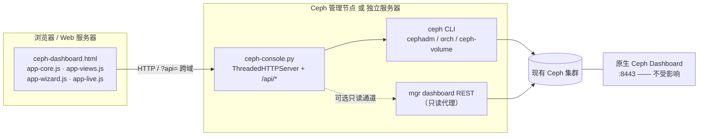

# Ceph Ops Console

面向运维团队的 **Ceph 集群监控告警 + 磁盘运维控制台**。

- 兼容 Ceph 12.x ~ 19.x 与主流 Linux 发行版，一键部署并对接**现有**集群；
- Web 页面直接 **一键踢盘 / 一键换盘**，带告警中心与变更审计；
- 真实后端（Ceph CLI / mgr Dashboard REST），不是演示数据；
- **完全不改动、不占用原生 Ceph Dashboard**；
- 支持「管理节点一体化启动」和「前端与后端分离部署」两种形态；
- 后端仅依赖 Python 3.6+ 标准库，前端零 CDN、零构建、可离线运行。

> ⚠️ 快速开始的安装命令带 `--allow-write`，装完即可**真实下发**踢盘 / 换盘命令；去掉该参数则默认 DRY-RUN（只生成命令 + 写审计，不改集群）。执行闸门与风险控制见 [一键踢盘 / 一键换盘](#一键踢盘--一键换盘)。

---

## 目录

- [核心能力](#核心能力)
- [架构](#架构)
- [兼容性](#兼容性)
- [快速开始](#快速开始)
- [登录与权限](#登录与权限)
- [一键踢盘 / 一键换盘](#一键踢盘--一键换盘)
- [告警中心](#告警中心)
- [与原生 Ceph Dashboard 的隔离](#与原生-ceph-dashboard-的隔离)
- [安全设计](#安全设计)
- [配置与文件位置](#配置与文件位置)
- [后端 API](#后端-api)
- [部署参数速查](#部署参数速查)
- [卸载](#卸载)
- [常用运维](#常用运维)
- [常见问题](#常见问题)
- [目录结构](#目录结构)

---

## 核心能力

| 能力 | 说明 |
| --- | --- |
| 集群概览 | HEALTH 状态、OSD 上下线、容量与 PG 状态、活跃告警、待处置故障盘、SVG 趋势图 |
| 告警中心 | 四级告警分级统计、筛选/确认/静默、告警直达故障 OSD 的一键处置入口 |
| OSD / 磁盘 | OSD 列表、主机与设备映射、元数据查询、标记 out / in |
| 存储池 / 主机 | 存储池用量、主机与 MON 视图 |
| 一键踢盘 | 标记 OUT → 等待回填 → 移除 OSD 与认证 → 清理设备 → 健康验证 |
| 一键换盘 | 移除 OSD → 清理元数据 → **暂停等待人工换盘** → 原 OSD ID 重建 → 回填观察 |
| 高级向导 | 5 步流程，逐步展示命令、预检项与执行结果 |
| 变更审计 | jsonl 全量记录（时间、用户、目标、命令、DRY-RUN / EXECUTED / REJECTED、来源 IP） |
| 部署与对接 | 页面内展示部署模式、原生 Dashboard 隔离自检、后端地址与登录态 |
| 登录 | 账号密码登录、admin / viewer 角色、会话过期、失败限速 |
| 主题 | 深色 / 浅色切换，纯前端实现 |

---

## 架构



- **前端**：静态文件，可由后端同源托管，也可放在任意 Web 服务器（Nginx / Apache），通过 `?api=<后端地址>` 指向后端。
- **后端**：`ceph-console.py`，同时提供静态文件与 `/api/*`，默认监听 `0.0.0.0:8780`。
- **两种数据通道**：`cli`（完整能力，需要 ceph CLI 与 keyring）/ `rest`（只读取 mgr dashboard API，不支持写操作）。

---

## 兼容性

| 维度 | 支持范围 |
| --- | --- |
| Ceph | 12.x Luminous ~ 19.x Squid（**运行时能力探测**，不按版本硬编码命令） |
| OSD 管理 | `cephadm / ceph orch`、`ceph-volume`、`ceph-disk` 自动选择；含 `ok-to-stop`、`safe-to-destroy` 检查 |
| Linux | RHEL / CentOS 7-9、Rocky / AlmaLinux、Fedora、Ubuntu / Debian、openEuler、Kylin V10 / UOS、SUSE，及通用 systemd / SysVinit 主机 |
| 初始化系统 | systemd（主）/ SysVinit（回退） |
| 防火墙 | firewalld / ufw / iptables，可 `--no-firewall` 跳过；SELinux 会给出提示 |
| 运行时 | Python **3.6+ 标准库**，无 pip 包、无编译、无需联网 |
| 浏览器 | 现代浏览器（原生 ES5+ JS / SVG，无需构建、无 CDN 依赖） |

> 后端仅面向 Linux 部署。由后端或任意 HTTP 服务器托管的页面**默认就是 LIVE 控制台**——打开先要求登录，用 admin 登录后进入真实数据视图（顶栏显示 `LIVE · …`）。只有两种情况会进入 **DEMO 模式**（本地模拟数据、不连接集群）：本地 `file://` 双击打开 `ceph-dashboard.html`，或在页面里**主动点**「运行模式 → DEMO 演示」/ 登录页「不连接后端，进入离线演示」。这个选择会被记住，刷新页面仍停留在 DEMO，点「LIVE 对接集群」即可切回。HTTP 页面想直接看演示，也可在地址后加 `?demo=1`。

---

## 快速开始

源码仓库：[cfree970415/ceph-ops-console](https://github.com/cfree970415/ceph-ops-console)。**两种形态二选一，选一个按下面的步骤从头做到尾即可**（服务默认端口 8780）。

- 【Ceph 节点】—— Ceph 管理节点（示例 `192.168.27.134`），有 `ceph` CLI，是真正下发命令的机器。
- 【Web 服务器】—— 仅形态 B 需要的另一台 Linux，只放静态页面。
- 【浏览器】—— 任意能访问上述服务器的电脑。

> 每个命令块都标了执行机器；源码统一 clone 到 `~/ceph-ops-console`，整段复制即可。

### 形态 A：管理节点一体化（推荐）

页面、API 后端、服务全部跑在【Ceph 节点】一台机器上。

**第 1 步 ·【Ceph 节点】拉取源码并安装**

```bash
# 在【Ceph 节点】执行
cd ~ && git clone https://github.com/cfree970415/ceph-ops-console.git

cd ~/ceph-ops-console && sudo bash deploy.sh --local \
  --host 192.168.27.134 --allow-write --install
```

安装结束时终端会打印访问地址、登录账号、初始密码、API token 与审计路径。**初始密码只显示一次，请立即保存。**

**第 2 步 ·【浏览器】访问**

```
http://192.168.27.134:8780/
```

登录后即可查看告警、执行一键踢盘 / 换盘。

### 形态 B：前后端分离

后端在【Ceph 节点】，前端在【Web 服务器】，两台机器都要 clone。

**第 1 步 ·【Ceph 节点】装后端**

```bash
# 在【Ceph 节点】执行
cd ~ && git clone https://github.com/cfree970415/ceph-ops-console.git

cd ~/ceph-ops-console && sudo bash deploy.sh --local --mode backend \
  --host 192.168.27.134 --allow-write --install
```

**第 2 步 ·【Web 服务器】装前端**

```bash
# 在【Web 服务器】执行
cd ~ && git clone https://github.com/cfree970415/ceph-ops-console.git

cd ~/ceph-ops-console && sudo bash deploy.sh --local --mode frontend \
  --backend-url http://192.168.27.134:8780 \
  --cors-origin http://<web-server> \
  --dir /var/www/ceph-console --install
```

**第 3 步 ·【浏览器】访问**

```
http://<web-server>/?api=http%3A%2F%2F192.168.27.134%3A8780
```

> 浏览器需能访问【Ceph 节点】的 8780 端口，`--cors-origin` 要放行前端站点；后端安装输出的初始密码同样只显示一次。

### 补充

- **安全开关**：安装命令里的 `--allow-write` 让一键踢盘 / 换盘真实下发；去掉它则默认 DRY-RUN（只生成命令 + 写审计，不改集群）。
- **内网访问不了 GitHub**：在能上网的机器 `git clone` 后 `scp -r ceph-ops-console/ root@<host>:~/`（或下载仓库 zip 解压），把命令里的 `~/ceph-ops-console` 换成实际目录即可。仓库内 7 个运行文件就是全部依赖，无需编译或联网安装。
- **不想用了**：卸载见 [卸载](#卸载)，一条命令停服务并删安装目录，可选 `--purge` 连配置、keyring、日志一起清理。

---

## 登录与权限

| 项 | 说明 |
| --- | --- |
| 账号存储 | `/etc/ceph-console/users.json`，权限 `0600`，仅保存 PBKDF2-SHA256（120000 轮 + 随机 salt）哈希 |
| 初始账号 | `--user`（默认 `admin`）；密码由 `--password` 或环境变量 `CEPH_CONSOLE_PASSWORD` 指定，未指定则自动生成并**只打印一次** |
| 会话 | HttpOnly + SameSite Cookie，请求头 `X-Console-Session`，默认 8 小时（`--session-ttl` 可调） |
| 服务 token | `X-Console-Token`，用于脚本/健康检查调用 API，存于 `/etc/ceph-console/env`（`0600`） |
| 角色 | `admin` 可执行真实 OSD 操作；`viewer` 可查看与 DRY-RUN 演练，真实执行返回 403 |
| 登录保护 | 300 秒窗口内连续 5 次失败后限速 |
| CORS | 可通过 `--cors-origin` 限制允许的 UI 来源，默认 `*` |

> `--no-auth` 可关闭登录，但**不推荐**：任何能访问该端口的人都能读取集群数据。

### 修改 admin 密码

**页面修改（日常用这个）**：登录 → 顶栏齿轮图标或左侧「系统设置」→「账号与密码」卡片 → 填当前密码、新密码、确认新密码 → 点「修改密码」。支持所有本地账号（含 `viewer`），改的是自己当前登录的账号。

| 规则 | 说明 |
| --- | --- |
| 校验 | 必须提供正确的当前密码；新密码至少 8 位、最多 128 位、不能与当前密码相同、不能带首尾空白 |
| 限速 | 当前密码连续输错同样计入登录限速（300 秒 5 次），防暴力猜解 |
| 存储 | 原子写入 `users.json`（`0600`），只存 PBKDF2-SHA256 哈希；明文不落盘、不进日志、不出现在接口返回里 |
| 会话 | 改成功后**同一账号的其他登录会话立即失效**，当前会话保持有效；审计写一条 `PASSWORD_CHANGE` |
| 权限 | 必须是用账号密码登录的会话；仅持 `X-Console-Token` 的服务令牌不能改密 |

**忘记密码 / 账号被锁（无需登录、无需重启服务）**：在【Ceph 节点】执行，脚本会用不回显方式提示输入两次新密码：

```bash
# 在【Ceph 节点】执行
sudo python3 ~/ceph-ops-console/ceph-console.py \
  --set-password admin --users-file /etc/ceph-console/users.json
```

脚本化场景可用环境变量传入（注意明文会留在 shell 历史里，执行后请清理）：

```bash
read -rs -p "New admin password: " PW; echo
sudo env CEPH_CONSOLE_NEW_PASSWORD="$PW" python3 ~/ceph-ops-console/ceph-console.py \
  --set-password admin --users-file /etc/ceph-console/users.json
unset PW
```

> 后端**每次登录都会重新读取** `users.json`，所以改完无需重启服务。若希望所有已登录会话立即失效，`systemctl restart ceph-console` 即可（会话只存内存）。
> 重跑 `deploy.sh --install` **不会覆盖已修改的密码**：未带 `--password` 时保留现有用户库（包括新增的其他账号），只有显式传 `--password` 才重置。

---

## 一键踢盘 / 一键换盘

从「告警中心」的故障告警、概览页的「待处置故障盘」，或「OSD / 磁盘」页均可发起。

**一键踢盘（退役 OSD）**

```
标记 OUT → 等待回填 → 移除 OSD 与认证 → 清理设备 → 健康验证
```

**一键换盘（保留原 OSD ID）**

```
移除 OSD → 清理磁盘元数据
   ↓  平台暂停，提示「物理更换故障盘」
现场换盘后点击「磁盘已换好，继续执行」
   ↓
原 ID 重建 → 回填观察 → HEALTH_OK / PG active+clean 确认
```

后端按探测到的 Ceph 版本与编排器自动选择命令模板；人工换盘由 `stage=pre` / `stage=post` 两段执行，**不会假装自动完成物理换盘**。

**四道闸门，缺一不可真正下发命令：**

1. 服务端启动参数 `--allow-write`（由 `deploy.sh --allow-write` 传入）；
2. 专用 keyring 具备写能力（安装默认 `--keyring full`）；
3. 登录角色为 `admin`，且请求带 `allow_write: true`；
4. 请求体携带正确的 `confirm_phrase`（格式 `osd.<ID>`）。

其余情况一律 DRY-RUN：返回完整命令列表、写入审计，但**不执行**。此外 OSD ID 强制整数校验、设备路径与主机名走白名单正则，所有外部命令以 argv 数组调用（不经 shell），避免命令注入。

---

## 告警中心

- 严重 / 警告 / 提示 / 静默四级统计与筛选；
- 告警关联 OSD、主机、设备与持续时间；
- 支持确认（ack）、静默，操作写入审计；
- 「待处置故障盘」卡片直接跳转一键踢盘 / 换盘；
- 概览页提供告警速览与「查看告警页面」入口。

---

## 与原生 Ceph Dashboard 的隔离

| 隔离点 | 做法 |
| --- | --- |
| 端口 | 使用独立端口（默认 8780）；部署前检测 8443 / 8080 / 3000 / 7000 / 9283 等常用端口，冲突即拒绝安装 |
| 配置 | **不修改** `ceph.conf`、不启用/停用任何 mgr 模块、不改动 dashboard 配置 |
| 凭据 | 使用独立客户端 `client.ceph-console` 与专用 keyring，不动 `client.admin` |
| 服务 | 独立进程 / systemd unit `ceph-console`，与 `ceph-mgr` 完全解耦 |
| 只读检查 | 仅通过 `ceph mgr services` 读取信息用于探测与展示 |
| 自检 | 页面「部署与对接」与 `GET /api/isolation` 可查看隔离状态 |

---

## 安全设计

- 不加 `--allow-write` 时默认 DRY-RUN，加后才真实执行；四重写开关（见上）；
- 参数强校验：`osd_id` 整数、`/dev/...` 设备路径白名单、主机名白名单；
- `subprocess` 使用 argv 数组，禁用 shell 拼接；
- `jsonl` 全量审计（`/var/log/ceph-console/audit.jsonl`），含来源 IP 与操作用户；
- 密码 PBKDF2 + salt，用户库 `0600`；会话 Cookie HttpOnly + SameSite；登录失败限速；
- 静态文件仅允许 `^[A-Za-z0-9._-]+$` 文件名且限制在安装目录内，防目录穿越；
- CORS 可收敛到指定前端来源；支持 `X-Console-Token` 服务鉴权。

---

## 配置与文件位置

> 以下路径均指 **【Ceph 节点】**（后端服务器）本机；形态 B 的【Web 服务器】上只有 `--dir` 指定的静态文件目录，没有配置、用户库、keyring 和审计日志。

| 用途 | 路径 |
| --- | --- |
| 安装目录 | `/opt/ceph-console`（`--dir` 可改） |
| 配置文件 | `/etc/ceph-console/config.json` |
| 用户库 | `/etc/ceph-console/users.json`（0600） |
| 服务 token | `/etc/ceph-console/env`（0600） |
| 专用 keyring | `/etc/ceph/ceph.client.ceph-console.keyring` |
| 审计日志 | `/var/log/ceph-console/audit.jsonl` |
| 运行日志 | `journalctl -u ceph-console -f`（SysVinit 为 `/var/log/ceph-console/console.log`） |
| systemd 服务 | `ceph-console.service` |

---

## 后端 API

所有 `/api/*`（除 `/api/session`、`/api/login`、`/api/logout`）均需会话或 token 鉴权。

| 方法 | 路径 | 说明 |
| --- | --- | --- |
| GET | `/api/session` | 当前会话、角色、写能力 |
| POST | `/api/login` | 账号密码登录 |
| POST | `/api/logout` | 登出 |
| POST | `/api/password` | 修改当前登录账号密码：需会话 + `old_password` + `new_password` + `confirm_password` |
| GET | `/api/probe` | Ceph 版本 / 编排器 / 能力探测结果 |
| GET | `/api/state` | 集群实时状态（20 秒缓存） |
| GET | `/api/plan` | 当前版本可用能力 |
| POST | `/api/plan` | 生成操作步骤与命令序列 |
| GET | `/api/progress` | 回填 / 任务进度 |
| GET | `/api/isolation` | 原生 Dashboard 隔离自检 |
| GET | `/api/audit` | 审计记录 |
| GET | `/api/osd/<id>/meta` | OSD 元数据 |
| POST | `/api/quick/kick` | 一键踢盘 |
| POST | `/api/quick/replace` | 一键换盘（`stage=pre` / `post`） |
| POST | `/api/execute` | 高级向导执行 |
| POST | `/api/osd/<id>/out` `/in` | 标记 OSD out / in |
| POST | `/api/alert/ack` | 告警确认 |
| OPTIONS | `/api/*` | CORS 预检 |

示例：

```bash
curl -H "X-Console-Token: <token>" http://192.168.27.134:8780/api/probe
```

---

## 部署参数速查

| 参数 | 默认值 | 说明 |
| --- | --- | --- |
| `--install` | 预览 | 真正执行安装；不加则只预览 |
| `--local` | — | 从脚本所在目录读取文件（本机安装） |
| `--mode` | `all` | `all` 一体化 / `backend` 仅 API / `frontend` 仅静态 UI |
| `--host` | — | 访问地址用的 IP 或主机名 |
| `--port` | `8780` | 服务端口 |
| `--dir` | `/opt/ceph-console` | 安装目录 |
| `--keyring` | `full` | 专用账号权限，默认即可，无需改动 |
| `--allow-write` | 关闭 | **允许真实 OSD 操作（危险）** |
| `--backend` | `cli` | `cli` 完整 / `rest` 只读代理 |
| `--rest-url` / `--rest-token` | — | mgr dashboard REST 通道 |
| `--user` / `--password` | `admin` / 自动生成 | 登录账号；密码推荐用 `CEPH_CONSOLE_PASSWORD`。**重装时不带 `--password` 会保留现有密码**，见 [修改 admin 密码](#修改-admin-密码) |
| `--backend-url` | — | `frontend` 模式下写入的后端 API 地址 |
| `--cors-origin` | `*` | 允许的 UI 来源，逗号分隔 |
| `--token` | 自动生成 | 服务 API token |
| `--no-auth` | 关闭 | 禁用登录（不推荐） |
| `--no-firewall` / `--no-service` | 关闭 | 跳过防火墙 / 服务注册 |
| `--install-deps` | 关闭 | 尝试安装 python3 / ceph-common |
| `--uninstall` / `--purge` | — | 卸载 / 连同配置、keyring、日志一起删除，详见 [卸载](#卸载) |

完整帮助：`bash deploy.sh --help`

---

## 卸载

> 卸载只清理本程序装在这台机器上的东西：**不动 Ceph 集群数据、不改 `ceph.conf` 与 mgr 模块、不影响原生 Ceph Dashboard**；`~/ceph-ops-console` 源码仓库也会保留，随时可重装。
> 必须加 `sudo` —— 脚本卸载时会静默忽略权限不足导致的失败，不用 sudo 看似执行成功、实际没删干净。

### 形态 A ·【Ceph 节点】一台机器

```bash
# 在【Ceph 节点】执行：保留配置卸载（用户库、token、审计日志留着，便于重装）
cd ~/ceph-ops-console && sudo bash deploy.sh --uninstall

# 在【Ceph 节点】执行：彻底卸载（连配置、keyring、日志一起删）
cd ~/ceph-ops-console && sudo bash deploy.sh --uninstall --purge
```

### 形态 B · 两台机器各卸一次

```bash
# 在【Ceph 节点】执行（后端服务）
cd ~/ceph-ops-console && sudo bash deploy.sh --mode backend --uninstall --purge

# 在【Web 服务器】执行（前端静态文件）
cd ~/ceph-ops-console && sudo bash deploy.sh --mode frontend --uninstall --no-firewall
```

> 前端卸载带 `--mode frontend` 后脚本会自动定位到 `/var/www/ceph-console`；若安装时自定义过 `--dir`，**卸载必须带同样的 `--dir`**。同理，安装时改过 `--port` 就要带同样的 `--port`，否则防火墙放行规则删不掉。前端安装本就不建服务、不改防火墙，故补 `--no-firewall` 避免误删同名规则。

### 卸载会删什么

| 项目 | `--uninstall` | `--uninstall --purge` |
| --- | --- | --- |
| 停止并禁用 `ceph-console` 服务、删除 systemd unit / init.d 脚本 | 删除 | 删除 |
| 安装目录（形态 A / 后端为 `/opt/ceph-console`，前端为 `/var/www/ceph-console`） | 删除 | 删除 |
| 防火墙 `8780/tcp` 放行规则 | 删除 | 删除 |
| `/etc/ceph-console/`（`config.json`、`users.json`、`env`） | 保留 | 删除 |
| `/var/log/ceph-console/`（含 `audit.jsonl` 审计） | 保留 | 删除 |
| `/etc/ceph/ceph.client.ceph-console.keyring` 文件 | 保留 | 删除 |

### 卸载不会删的（需要手动处理）

- **Ceph 集群里的 `client.ceph-console` 认证账号**：脚本只删本机 keyring 文件，不执行 `ceph auth del`。确认永不再用、也不打算重装时，在【Ceph 节点】执行 `ceph auth del client.ceph-console`；提前删除反而能避免重装时 caps 不匹配。
- **形态 B 自己配的 nginx / Apache 站点配置**：脚本只删静态文件目录，虚拟主机配置需手动移除。
- **`~/ceph-ops-console` 源码仓库**：保留，供重装或升级使用。
- **Ceph 集群本身**：OSD、存储池、`ceph.conf`、mgr 模块、原生 Dashboard 均不受影响。

卸载后校验：`systemctl status ceph-console` 应提示找不到服务，`ls /opt/ceph-console` 应不存在。

---

## 常用运维

> 以下命令均在 **【Ceph 节点】** 执行。其中 `curl` 也可从任意能访问 8780 的【本地终端】发起，把 `127.0.0.1` 换成后端 IP 即可。卸载请见 [卸载](#卸载)。

```bash
systemctl status ceph-console          # 服务状态
systemctl restart ceph-console        # 重启
journalctl -u ceph-console -f         # 实时日志
tail -f /var/log/ceph-console/audit.jsonl   # 审计
curl -H "X-Console-Token: <token>" http://127.0.0.1:8780/api/state
```

---

## 常见问题

**Q：页面显示 DEMO / 没有真实数据？**
用 admin 登录成功后一定是 LIVE 控制台。若仍显示 DEMO，只可能是：本地 `file://` 双击打开，或之前点过「DEMO 演示」/「不连接后端，进入离线演示」（该选择会记住，刷新仍为 DEMO）。点设置页「运行模式 → LIVE 对接集群」即可切回，已保存的会话会自动恢复，通常无需重新输密码。分离部署时确认 URL 的 `?api=` 参数或登录页填写的后端地址正确，且 `--cors-origin` 放行前端来源。

**Q：顶栏显示「LIVE · 等待后端数据」？**
说明登录成功但 `GET /api/state` 尚未取到集群数据，此时界面不会用演示数据冒充真实状态。检查后端主机 `ceph -s` 是否可执行、keyring 权限是否足够，以及 `GET /api/probe` 的能力探测结果；同步成功后顶栏会自动变成 `LIVE · <集群名>`。

**Q：登录后看不到集群状态？**
确认后端主机可读取 ceph 配置与 keyring（`ceph -s` 可执行）、`client.ceph-console` 权限充足，并查看 `GET /api/probe` 返回的能力探测结果。

**Q：点了一键踢盘但集群没变化？**
先确认服务是否处于 DRY-RUN：按快速开始安装时带了 `--allow-write`，应已开启真实执行；检查 `/api/session` 是否返回 `allow_write: true`、登录角色是否为 admin。若当初去掉了 `--allow-write`，改 `/etc/ceph-console/env` 中的 `CEPH_CONSOLE_ALLOW_WRITE=1` 后 `systemctl restart ceph-console` 即可，无需重装。

**Q：`rest` 后端为什么不能换盘？**
REST 通道是 mgr dashboard 的只读代理；OSD 写操作需要 `cli` 后端与 ceph CLI。

**Q：端口被占用 / 安装被拒绝？**
部署脚本会在安装前检查常用 dashboard 端口，换一个 `--port` 即可，不会去改动原生 Dashboard。

**Q：忘记 admin 初始密码 / 想修改密码？**
页面修改见 [修改 admin 密码](#修改-admin-密码)（系统设置 → 账号与密码）。忘记密码时在【Ceph 节点】离线重置，无需重装、无需停服务：

```bash
sudo python3 ~/ceph-ops-console/ceph-console.py \
  --set-password admin --users-file /etc/ceph-console/users.json
```

注意：**重跑 `deploy.sh --install` 且不带 `--password` 现在会保留现有密码**，别再指望重装能重置；要重置请显式带 `--password`。

---

## 目录结构

以下即 `git clone` 得到的仓库内容。`deploy.sh` 会把其中 7 个运行文件复制到安装目录（默认 `/opt/ceph-console`），仓库本身保留在 `~/ceph-ops-console` 供升级、重装与卸载使用。

```
.
├── README.md                 # 本文档
├── .gitignore                # 排除凭据与运行数据
├── .gitattributes            # 强制 LF 换行（deploy.sh 必须 LF）
├── deploy.sh                 # 多发行版 Linux 一键部署 / 卸载脚本
├── ceph-console.py           # 后端：静态托管 + /api/* + Ceph 能力探测与执行
├── ceph-dashboard.html       # 前端页面骨架与样式
├── app-core.js               # 状态、API 客户端、图表、概览与顶栏
├── app-views.js              # 告警 / OSD / 存储池 / 主机 / 审计 / 部署 / 设置
├── app-wizard.js             # 高级 5 步向导、弹窗与事件绑定
└── app-live.js               # 登录、跨机后端连接、一键踢盘 / 换盘
```

---

## 说明

- 本工具面向已有 Ceph 集群的运维场景，部署前请在测试环境验证命令序列与 keyring 权限。
- `users.json`、`config.json`、`env`、`audit.jsonl`、`*.keyring` 等含凭据或运行数据的文件已由 `.gitignore` 排除，**切勿提交到仓库**。
- 许可证未在此声明，如需公开发布请由仓库维护者补充 `LICENSE` 文件。
